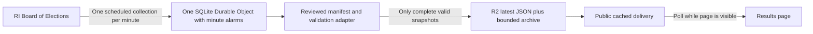

# Election Day 2026 — Results maintainer guide

This is the **single maintained guide** for the Results page in `2026/11/03/election-day`. Update this file when behavior, data, hosting or release procedures change. Machine-readable audits and test evidence stay in `data/results/` and `docs/evidence/`; they are supporting records, not separate instructions.

The page covers Rhode Island governor, Providence mayor and **Providence’s Question 7** (a municipal measure). **Production collection started automatically at 8 p.m. EST on November 3 and is running.** This checkout connects to the shared production snapshot. Remote mock tests, a two-cycle real-source rehearsal, repeated production publication, public delivery and automatic email alerts passed verification. The official source still contained zero votes during launch checks; the viewer correctly awaits returns. Publishing this checkout to GitHub Pages is a separate step; see the publishing checklist and [launch verification](docs/evidence/cloudflare-launch-verification.json).

**Ownership and budget:** use the Herald Cloudflare account `44add93f0807dcac364f9aa9a2d28d20` (`techadmin@browndailyherald.com`). On November 3, the user approved **$5/month plus possible overages**, replacing the earlier $0/strict-$5 requirement. Workers Paid is active; checkout confirmed the $5 base charge. The target is the included allowances, not a guaranteed $5 total. Use Cloudflare's provided hostname; no GoDaddy record or custom domain is needed. Personal infrastructure is excluded. Workers and R2 can incur metered overages, and the subscription renews monthly until changed.

## Contents

- [Ownership and service](#ownership-and-service)
- [Local preview](#local-preview)
- [Reader experience](#reader-experience)
- [Reporting links and editorial choices](#reporting-links-and-editorial-choices)
- [Population representation](#population-representation)
- [Current boundaries and matching](#current-boundaries-and-matching)
- [Data architecture and collector](#data-architecture-and-collector)
- [Publishing checklist](#publishing-checklist)
- [Collector operation and deployment](#collector-operation-and-deployment)
- [Historical and mock validation](#historical-and-mock-validation)
- [Tests and asset preparation](#tests-and-asset-preparation)
- [Hosting rationale and cost assumptions](#hosting-rationale-and-cost-assumptions)
- [File map](#file-map)

## Ownership and service

The Herald owns the Cloudflare account and R2 buckets. The project site remains on GitHub Pages; data uses `herald-election-data-2026.pages.dev`. No DNS migration, GoDaddy record or personal domain is needed.

**Initial incident owner: Nikos.** Health notifications go to his nominated Gmail inbox and `techadmin@browndailyherald.com`; manage exact destinations in Cloudflare → Observability → Alerts → Monitors. The owner acknowledges an alert, checks the public verification timestamp and collector logs, and coordinates recovery with a Herald developer. Someone must monitor those inboxes during coverage. Email delivery was tested and Nikos confirmed receipt. The technical admin should confirm their own inbox receives it and arrange a backup when Nikos is unavailable. Billing warnings go to the technical admin; review usage during coverage and the subscription before its next renewal.

The [paid-plan verification](docs/evidence/cloudflare-paid-plan.json) records the budget decision. Administrative credentials stay in ignored local files and Cloudflare secrets, never in this public guide. Transfer them through the team's secret manager before relying on a second operator.

**Implemented delivery:** a small Pages Function reads only the validated R2 snapshot and caches it for 15 seconds. Production and mock previews have separate buckets and explicit mode checks. The production address is [the shared snapshot](https://herald-election-data-2026.pages.dev/ri-2026-general/latest.json); it returns HTTP 503 until the first accepted scheduled publication, then serves the complete live snapshot. No test data was placed in production. An optional branded subdomain could later be registered in Pages and added as a GoDaddy CNAME, without moving the parent domain. [Pages deployment addresses](https://developers.cloudflare.com/pages/get-started/direct-upload/), [Pages custom domains](https://developers.cloudflare.com/pages/configuration/custom-domains/), [R2 bindings](https://developers.cloudflare.com/pages/functions/bindings/#r2-buckets)

When enabled, the collector checks the official source once per minute for the entire site. Reader downloads are separate: Pages Functions share Workers Paid's **10 million requests and 30 million CPU milliseconds per billing month**, including Function cache hits. The load test handled the request rate for 1,000 readers. Three uninterrupted days at that audience would mean 4.32 million polls before initial loads, retries and other account usage, within the request allowance. The former Free plan's 100,000 daily limit was the reason for upgrading. R2 has separate included allowances and metered overages. [Functions pricing](https://developers.cloudflare.com/pages/functions/pricing/), [Workers pricing](https://developers.cloudflare.com/workers/platform/pricing/), [R2 pricing](https://developers.cloudflare.com/r2/pricing/)

The earlier direct-R2 delivery plan requires a Cloudflare zone in the bucket's account. A simple GoDaddy CNAME is not a Free workaround: partial external-DNS setup requires Business/Enterprise, and a separately delegated subdomain zone requires Enterprise. Do not change Herald nameservers as an election-night shortcut. Direct R2 remains an alternative only if Herald separately approves a full DNS migration; the collector does not depend on that choice. [R2 public buckets](https://developers.cloudflare.com/r2/buckets/public-buckets/), [partial setup](https://developers.cloudflare.com/dns/zone-setups/partial-setup/), [subdomain setup](https://developers.cloudflare.com/dns/zone-setups/subdomain-setup/)

## Local preview

The viewer is plain HTML, CSS and browser modules. No frontend build or npm installation is required. From the repository root, use the existing preview server or run:

```sh
python3 -m http.server 8000
```

Do not start another server if port 8000 is already serving this checkout.

| URL | Purpose |
| --- | --- |
| [Results](http://127.0.0.1:8000/2026/11/03/election-day/results.html) | Production feed; waiting until the scheduled start |
| [Historical primary](http://127.0.0.1:8000/2026/11/03/election-day/results.html?mode=historical) | Official primary fixture, clearly labeled historical |
| [Simulated election night](http://127.0.0.1:8000/2026/11/03/election-day/results.html?mode=mock) | Invented counts with accelerated updates and failure controls |

Add `contest=mayor` or `contest=question7` to select a race. Governor is the default. Local mock scenarios accept `scenario=delayed`, `failure`, `malformed`, `correction` or `ended`; the visible preview controls also select these. Pause and Next update allow repeatable checks. “Coverage ended” preserves the current simulated totals and verification time, stops automatic checks and disables Pause/Next until another scenario is selected.

Preview controls and test modes work only on the exact `CONFIG.previewHosts` entries: `localhost`, `127.0.0.1` and `[::1]` by default. A separate Herald staging hostname can be explicitly added for QA, but **never add the public site**. A URL parameter cannot enable previews on an unapproved host.

## Reader experience

A new **Results** tab sits alongside the existing coverage sections. The original Election Day photo hero, logo, bylines and credit match the other coverage pages. A race menu is integrated into the race heading: click/tap the heading or adjacent chevron to show one contest at a time. The menu opens 16 px below the heading. Arrow keys/Home/End move among choices, Enter/Space selects, and Escape closes and returns focus to the trigger. Outside clicks and leaving the control close it. The serif heading retains its typography; hover and keyboard focus use the shared neutral gray `--placeholder` color (`#d9d9d9`), darker than the selected item's background. Each contest has overall candidate or answer totals, inline share bars, a reporting link and an interactive map. Town, ward and precinct results appear only in floating tooltips; there are no geographic tables or below-map detail panels. The default page uses the production feed and links to the official results. It does not display invented numbers as live returns.

The governor map starts with Rhode Island’s **39 cities and towns**. Counties are too coarse for this coverage. Selecting a municipality opens its geographic precinct map. The mayor and Question 7 maps start with Providence’s precincts. Providence has 15 wards; ward or council-district grouping is also available in 12 other municipalities where the boundaries and reporting units permit it.

Hover or keyboard focus opens a floating tooltip with every choice’s votes and percentage, “Votes reported,” and Election Day/early/mail subtotals. Mouse tooltips follow the cursor; pinned touch details stay within the viewport. A mouse click on a town opens precincts. On a touch screen, the first tap pins the details and a second tap on that same region opens the drill-down. Enter/Space on a map region supports the same two-step selection, and a **View precincts** button is always available when the selected region can be expanded. Dragging and pinching do not count as taps. Choosing a town or ward from the area menu opens its geographic precinct map immediately when child boundaries exist. Choosing a leaf reporting area opens its tooltip instead. The area menu and arrow-key navigation provide alternatives for small shapes and keyboard users. A second tap on a precinct zooms to that precinct. A separate outline drawn above all neighboring polygons keeps the full hovered or selected border bold.

Zoom, pan, selection, map type and drill-down depth remain in place when a result update arrives. Updates do not jump the reader back to the statewide map or scroll the page. Motion preferences disable the population animation. Text, numeric totals and the legend supplement color.

All five coverage pages use the same versioned navigation script and stylesheet. The active tab's underline is its CSS border and appears immediately, with no cross-page sliding animation. Tab navigation preserves the bar's viewport position using the shared navigation logic. Initial layout changes are followed until the first pointer, touch, wheel or keyboard interaction; afterward the reader controls scrolling. A hash change or page exit also releases restoration. Results reserves at least one viewport minus the tab-bar height below the bar, even before its asynchronous maps load, so restoring a pinned bar cannot be clipped by an initially short document. Its zero top margin requires this full height; the other pages' minimum height subtracts their separate top margin. Results control styles are scoped inside its main content so the shared mobile navigation keeps the other pages' typography and focus treatment. Direct visits, reloads, back/forward navigation and explicit anchors retain their existing scroll behavior. Keep the shared script/style version consistent across all five pages when releasing navigation changes.

## Reporting links and editorial choices

The `coverage` map near the top of `results/app.mjs` controls each race’s link text and destination. All three now point into the Ballot page. `script.js` preserves explicit slide IDs and selects the linked slide before scrolling, on initial load and hash changes. The shared script URL carries a release version so a cached older script cannot overwrite the new anchor; bump that version consistently across the pages when changing slide-link behavior. Verify external background links before publication.

| Race | Current link | Other existing coverage |
| --- | --- | --- |
| Governor | [General-election candidate guide](ballot.html#governor-title) | [Final gubernatorial debate](https://www.browndailyherald.com/article/16a90458-0757-40c9-ad76-38e497cb3adf), or [Foulkes’s primary win](https://www.browndailyherald.com/article/helena-foulkes-wins-democratic-nomination-for-ri-governor-20260910) for background |
| Mayor | [General-election candidate guide](ballot.html#mayor-title) covering Morales and Talan | [Morales’s primary win](https://www.browndailyherald.com/article/draft-bi-mayor-primary-results-20260910), [Morales interview](https://www.browndailyherald.com/article/mayoral-candidate-david-morales-shares-his-vision-for-change-in-providence-20260907), or [Providence’s progressive primary wave](https://www.browndailyherald.com/article/39ed3a87-da59-4aba-b54a-11efbe48a09b) |
| Question 7 | [Question 7 explanation](ballot.html#question-7), which opens that slide directly | [Divestment referendum coverage](https://www.browndailyherald.com/article/fc4f4c85-ad28-4b70-a509-6f30c2278f22) |

The labels are “Meet the candidates →” for governor/mayor and “What Question 7 would change →” for the measure. A separate “More coverage →” link could point to `previous-coverage.html` if the editor wants multiple destinations. Candidate-specific and primary stories should be labeled as background, not a comparison of the current general-election candidates.

Editorial review item: the Morales biography in `ballot.html` currently links the word “promised” to Talan’s platform while discussing Morales’s rent-stabilization pledge. Verify and correct that source before publication; this implementation has not silently changed that reporting.

## Color and arithmetic

Candidate hues remain stable across updates: Democrat blue, Republican red, distinct colors for independents and gray for write-ins. Question 7 uses teal for Approve and orange for Reject. Historical Democratic primary candidates have distinct hues despite sharing a party.

Color identifies the current leader. Intensity represents the percentage-point lead over the runner-up, calculated using **all valid votes in that contest**, including independents and write-ins. The scale runs from 0 to 40+ percentage points. A compact key shows choice colors, no results, ties and “Darker = larger lead.” Ties for first place use equal-width stripes in the actual tied choices’ colors, including a tie among every choice. A tie among trailing choices is not a map tie. Zero votes stay neutral. The legend uses generic light/dark beige stripes (`#fcf8ef` and `#d4c7b5`), reused from this page's existing warm neutral palette; these are not claimed as official Herald brand tokens. Each map region still uses its own tied leaders. Areas without votes remain neutral; map areas without a reporting unit have a distinct boundary treatment and explanatory text. A lead is never presented as a winner call.

The candidate palette is unchanged. Distinct hues distinguish same-party candidates in historical primaries; do not use different darknesses of the same hue for identities because darkness already communicates margin. Independents have separate gold, purple and green colors, not a shared “other” color. Names and party text remain necessary, especially where light tints are hard to distinguish.

Vote shares are `choice votes / sum of all choices’ valid votes`. An unreported denominator is displayed as a dash, never a fabricated percentage. An undervote is no selection in a single-choice contest; an overvote is more selections than allowed. Neither contributes to a candidate/answer vote share. The selected export does not provide a dependable per-contest undervote/overvote series here, so those counts are not invented. “Reporting units reported” is **not** “percent of votes counted,” and does not mean all mail, provisional or corrected votes are final.

## Population representation

The governor map can switch between **Geographic** and **Population**. Population means the July 1, 2025 resident population, including children and people who cannot or do not vote. It does not mean votes cast, registered voters or turnout. The weights remain fixed throughout election night. The municipality’s results, color, controls and selection stay the same during the switch. Opening a town always uses geographic precincts; returning to the state restores the prior map choice.

The population map is a precomputed continuous area cartogram. A shared deformation moves the municipalities’ common border vertices together. It is not a collection of independently scaled shapes, and it does not require runtime geographic computation in the collector. Coastlines deform and islands remain islands. The browser interpolates corresponding vertices over 750 ms.

Weights come from the [U.S. Census Bureau’s 2025 municipal estimates, published by RI DLT](https://dlt.ri.gov/sites/g/files/xkgbur571/files/2026-05/townest.pdf). The 39 figures sum to 1,114,521 residents. The build uses a local Albers equal-area projection, shared boundary simplification and the continuous-area method described by Dougenik, Chrisman and Niemeyer. The final asset’s maximum relative error between a town’s area share and population share is **0.100%**. Forty-one animation positions were checked before and after serialization for valid polygons, overlapping area and shared-border coverage. See [the geographic audit](data/results/geography-audit.json).

The geographic assets are generalized for display: precinct boundaries use a 20-meter simplification; statewide town outlines use 65 meters followed by a shared 5-meter precision grid to remove tiny source slivers. The latter changes any municipality’s area by at most 0.279% beyond simplification. Precinct detail does not use the extra town-level grid. These are thematic election maps, not address or legal-boundary lookup tools.

## Current boundaries and matching

Use the [current published RIGIS precinct service](https://services2.arcgis.com/S8zZg9pg23JUEexQ/ArcGIS/rest/services/BND_Voting_Precincts_2022/FeatureServer/0), checked November 3, 2026. Its name refers to the 2022 redistricting cycle. Its data was last edited November 27, 2023; its service metadata was edited September 11, 2024 and catalog item January 6, 2025. Those dates are not interchangeable. The audit found no newer statewide precinct layer. A separate service named `Voting_Precincts` is older, despite its newer catalog-modification date.

The general-election governor source contains **454 reporting units**: 414 geographic precincts that match polygons and 40 LIMITED units without geographic boundaries. All ordinary reporting codes matched. Providence governor has 82 geographic precincts plus two LIMITED units; mayor and Question 7 each have 82 geographic precincts and no LIMITED units. Nongraphic votes remain included in town/state totals and are disclosed in details, but never assigned to invented polygons.

A fresh general-election export checked at 18:31 UTC on November 3 contains **no combined precinct units** for these three contests. Primary governor data has 41 combined reporting groups; that is a historical-source fact, not an assumption about this election. General and primary have separate reviewed manifests. If the live source changes its grouping, the collector retains the last valid publication and reports a validation error until the new roster is reviewed.

The GIS layer contains 416 polygons. Preserve its two additional areas:

- **Cranston 0727:** the city’s [November 2026 election warrant](https://www.cranstonri.gov/nov-3-2026-general-election-warrant-and-polling-places/) says no voters and no polling place. Label it accordingly.
- **Providence 28XX:** the city’s [current Ward 12 PDF](https://www.providenceri.gov/wp-content/uploads/2026/05/ward-12.pdf) includes this area, but the results export has no matching unit. Label it “No results reported for this map area.” Do not alias it to another precinct or imply a reported zero.

The current [Providence ward PDFs](https://www.providenceri.gov/canvassers/ward-maps/) support the GIS ward membership. The Ward 8 PDF omits the label 2806, but the polygon, the current polling-location service and the election’s Ward 8 council contest support its membership. Sixty-nine current council contests across 12 municipalities matched the GIS groups with no discrepancies. This validates identifiers and grouping; it is not an exhaustive survey of every boundary line in all 39 municipalities.

| Municipality | Grouping |
| --- | --- |
| Central Falls | 5 wards |
| Coventry | 5 council districts |
| Cranston | 6 wards |
| Cumberland | 5 council districts |
| East Providence | 4 wards |
| Johnston | 5 council districts |
| Lincoln | 5 council districts |
| Newport | 3 wards |
| North Providence | 3 council districts |
| Pawtucket | 6 council districts |
| Providence | 15 wards |
| Warwick | 9 wards |
| West Warwick | 5 wards |

Cumberland’s current council terms do not require a 2026 council contest; its current town materials and fire-district contests support the five groups. Some West Warwick wards elect in alternating cycles. Do not infer the total number of wards from just the contests on one ballot.

The join key is the **public four-character geographic code**, with leading zeros retained. Internal BOE precinct IDs and polling-place names are not unique. For combined historical units, extract all four-digit codes from the final parenthetical, including labels separated with periods, and retain one combined result. Detect LIMITED units before extracting codes. Reject unknown codes, wrong-town codes, overlapping code sets or missing expected coverage.

## Data architecture and collector



The source is fetched **once per collection cycle for the whole site**, independent of reader count. Readers periodically download the same small normalized file. They do not contact the Board of Elections or trigger a new collection. Each reader poll consumes a request from the account's monthly Workers Paid allowance. Polling can add up to another minute of reader delay after publication; source caching and edge caching must also be accounted for.

The main source is the [official full general-election JSON export](https://electionresults.ri.gov/cdn/results/RhodeIsland/export-2026StatewideGeneralElection.json). Its observed cache lifetime is 60 seconds. The reviewed IDs are governor 4, Providence mayor 280 and Providence Question 7 417. The host-independent adapter is `results/boe-adapter.mjs`; it validates against `data/results/general-manifest.json`. The manifest is a reviewed build artifact, not something regenerated automatically in response to an unexpected election-night roster change.

The browser connection point is **`CONFIG.endpoint` in `results/config.mjs`**, set to `https://herald-election-data-2026.pages.dev/ri-2026-general/latest.json`. The deployed collector uses a SQLite Durable Object in the Herald account on Workers Paid. The normalized contract keeps the viewer independent of the host. The delivery service uses HTTPS, allows the project's origin through CORS and exposes no reader credentials.

The implementation includes durable minute alarms, a five-minute alarm-repair watchdog, conditional source requests, bounded downloads, validation, changed-source gzip archives, atomic publication, restart recovery and authenticated administration. Remote mock tests used real SQLite and R2, and reader tests verified HTTPS/CORS/cached delivery. Production is enabled on Workers Paid. The private actual-source rehearsal validated and stored two successive snapshots without putting test data into production. A separate monitor checks public delivery every two minutes; the launch record distinguishes verified checks from remaining publication tasks.

### Snapshot contract

| Field | Meaning |
| --- | --- |
| `schemaVersion` | `1`; incompatible versions are rejected |
| `electionId` | `ri-2026-general` for live, `ri-2026-primary` for the historical fixture |
| `mode` | `live`, `historical` or `mock`; a mock snapshot cannot enter the live feed |
| `revision` | Nonempty identifier for the source version or normalized content |
| `sourceUpdated` | Time supplied by the election source, not the browser’s clock |
| `publishedAt` | Time this validated publication was produced |
| `checkedAt` | Most recent successful collection/validation check |
| `coverageEndedAt` | Optional explicit end-of-coverage timestamp; independent of result certification |
| `status` | `waiting`, `unofficial`, or explicitly verified `certified` |
| `source` | Public source label and URL |
| `contests` | Exactly `governor`, `mayor`, `question7` |

Each contest has stable choice IDs, names, parties and colors, plus `areas` keyed by state, municipality, precinct/reporting group or ward. Each area has candidate-aligned `votes`, a `total`, three candidate-aligned voting-method arrays, reporting-unit counts, a status and any nongraphic votes. `geometryIds` lists every polygon belonging to a reporting unit. Combined historical units keep all their polygons under the same result. An unavailable historical contest has `available:false` and no fabricated areas. The prepared fixture files are working examples.

Reject negative, fractional or unsafe-integer counts; changed election/candidate identities; missing or duplicate reporting units; unexpected status/method values; non-reconciling candidate, method, ward, town or state totals; and older snapshots. Accept a newer legitimate correction even when votes decrease. Publish the entire three-contest file atomically only after validation passes. Keep the preceding valid snapshot on any failure. A future multi-endpoint collector must additionally verify all fragments belong to one source publication version before publishing.

The browser validates received snapshots again, enforces a 2 MB decoded-response limit and a 12-second request timeout, ignores obsolete responses after a mode change, and retains the last good data in memory and optional local storage. It polls every 60 seconds while visible, pauses polling while hidden, checks immediately on return and backs off to at most four minutes after failures. It never silently replaces a rejected update with zeros.

The reader sees one freshness note: **“Last verified 2 min ago (8:42 PM EST)”**. It measures the collector’s **`checkedAt`**: the last successful check of the official source, even if vote totals did not change. The old “Source updated” label used the official export’s `createdAt` (`sourceUpdated`); the old “Last checked” label used `checkedAt`, not the browser's download time. The source timestamp and exact verification time remain available in the note's hover text, with raw `data-source-updated` and `data-last-verified` values for inspection.

The age refreshes every 15 seconds while the page is visible, independently of network requests and retry backoff. The live sumdeck reads **“Results update automatically as they come in”**, including while awaiting returns, with no configured endpoint, during failed/rejected requests and during stale cached delivery. These conditions do not add warning text, retry labels, amber styling or a different status message. The last valid results stay visible, and downloading the same cached file never advances the verification time. Until a successful source check is available, no verification timestamp is shown. Scheduled/unconnected placeholders neither claim verification times nor enter the live cache. Historical results show their source date; an intentionally paused simulation says “Paused.” After coverage ends, the note uses a fixed, fully dated last-verification time instead of a growing relative age.

### Start, activity indicator and stopping

Rhode Island polls close at **8 p.m. Eastern on November 3, 2026**. The shared default `LIVE_STARTS_AT` in `results/schedule.mjs` is `2026-11-04T01:00:00Z` (EST, UTC−5, not daylight time). The viewer uses `CONFIG.startsAt`; the deployed collector uses `COLLECTION_STARTS_AT` with the shared constant as fallback. Keep them aligned if deliberately changing the schedule. [Official polling hours](https://elections.ri.gov/polling-hours)

With a real endpoint configured, an open page loads the honest waiting fixture before the start and automatically requests the endpoint at the start boundary, without a reload. A later visitor starts immediately. The collector must first be deployed, enabled and **armed using `/admin/start`**: before 8 p.m. that persists an alarm for 8 p.m.; after 8 it schedules the first eligible check about one second later. Manual checks, early alarms and watchdog recovery cannot fetch before the configured start. The watchdog never arms a deliberately stopped collector. Scheduled alarms and network delivery can run late, so “8 p.m.” is the start of checking, not a guarantee that votes exist at that instant. The deployed collector was armed before this boundary: status reported `scheduled`, zero attempts and `nextAlarm=1793754000000`; an early manual check returned `before-start`. A new deployment does not by itself arm a stopped collector.

The red dot beside “Election results” means **automatic checks are enabled**, not that the data is fresh or votes have increased. It keeps pulsing during fetch errors, rejected updates, stale snapshots and retry backoff; the last-verified note remains the record of the most recent successful source check. It is off for ended coverage, unconfigured/scheduled/historical data, invalid start configuration, hidden tabs, a stopped viewer feed and a paused simulation. A running mock preview can exercise it, but remains prominently labeled simulated and has a simulation-specific accessible label. Reduced-motion preferences use a steady red dot.

**Stop policy:** do not stop at midnight, at 100% reporting units, on a lead or on a race call. Mail/provisional counts and corrections can arrive later. `/admin/stop` is a temporary operational stop: it preserves the latest file, normal reader copy and last-verification timestamp. The browser continues checking for resumed publication without displaying warnings. The existing `COLLECTION_ENDS_AT = 2026-11-30T23:59:59Z` remains an operational safety cutoff, not an assertion that counting or certification is complete; review/extend it before then if needed. A slower post-election polling cadence is not implemented.

**End coverage explicitly with `POST /admin/finish`.** This authenticated operation waits for in-flight collection, then atomically republishes the last verified snapshot with `coverageEndedAt`. It preserves vote totals, source revision, `checkedAt`, and the existing unofficial/certified status. A verified snapshot is required. Readers display **“Live updates have ended.”**, retain the results and exact last-verification time, hide the live dot and stop polling after receiving this snapshot. A failed closing publication is persisted and retried by the alarm/watchdog without another source fetch; `/admin/status` reports `ending` until publication completes, then `ended`. Repeating the operation is safe. The latest object does not expire.

`POST /admin/start` can deliberately reopen completed coverage within the configured collection window. The next successful source check removes the coverage-end marker, including for an unchanged 200/304 response. Readers of the archived page can reload to receive the reopened feed; a fresh visit revalidates cached archive metadata once, and retains the archived state if that fetch fails. The deployed collector includes this finish operation. Local preview/testing does not end actual election coverage.

### Collector behavior and launch requirements

Use conditional requests (ETag/Last-Modified) where supported, explicit response-size and timeout limits, and a timeout timer cleared after success. A successful not-modified response may advance the health check without changing vote data. Preserve source timestamps and record the original source hash/version for audit. Fetch failure, changed schema, unknown geography or reconciliation failure keeps the last good publication and records an actionable error.

For a Durable Object, use one named object for the election and its one-shot alarm. Persist state, schedule the next alarm deliberately, avoid overlapping collections and make retries safe. Local workerd tests verify repeated minute alarms, SQLite restart recovery and R2 publication. The deployed mock collector also completed three real minute alarms against real R2: a populated result, a 304 and a downward correction. A bounded private rehearsal also fetched the actual BOE export twice, one minute apart, validated all three contests and wrote real R2 snapshots. It then stopped; the test Worker was restored to mock-only code and disabled. Keep polling readers outside the collector object. Cache lifetime is an expiration policy, not an obligation to delay new data for 60 seconds. Do not use cache-busting URLs per reader.

The incident contacts and separate health monitor are configured; see the operating procedure below. A stale successful-check timestamp detects sustained collection failure or rejected source changes even if the delivery URL still returns HTTP 200. Keep an official-source link visible during an outage. Do not automatically call races or promote an unofficial source to certified without an explicit trustworthy certification signal or reviewed editorial action.

## Publishing checklist

### What happens automatically

| Behavior | Public site | Approved local/staging host |
| --- | --- | --- |
| Preview controls | Hidden from the initial HTML render onward | Available via “Preview test data” |
| `?mode=mock` / `?mode=historical` | Ignored and removed from the URL; only live/waiting data is accepted | Opens the requested labeled test feed |
| Feed mode switching | Cannot enter mock/historical mode without preview permission | Test mode switching allowed |
| Test banners | Absent because no test feed is shown | Persistent warning whenever test data is displayed |
| No configured endpoint | Honest waiting state and official-results link | Same waiting state, plus optional tests |
| Failed or rejected update | Last valid data and verification time retained, with normal update copy and no warning | Same behavior; mock controls can simulate it |
| Coverage ended | Final retained snapshot and dated verification time; no polling or live dot | “Coverage ended” scenario exercises the same state with simulated data |

**There is no manual “remove preview UI” step for normal publication.** Keep production out of `previewHosts`. These controls are an editorial safeguard, not an access-control system: the repository and fixture files can remain publicly downloadable under GitHub Pages. They contain public historical or explicitly synthetic data, never secrets. If a future release must omit test assets entirely, prepare an explicit deployment bundle rather than assuming hidden controls make the files private.

### What a maintainer must do

1. **Check service health.** In `collector/`, run `npm run admin -- status` and `npm run admin -- health` using the private credentials. Before 8 p.m. the collector must be `scheduled` with the expected alarm. Afterward it must be `running`, with advancing successful checks and no persistent failures. Compare all three totals with the official source when returns appear. Launch evidence records the checks already completed; repeat when changing service code or configuration.
2. **Confirm the handoff.** Nikos is the initial incident owner. Confirm the technical admin receives the test email, arrange backup coverage and securely share both administrative tokens with the responsible developer. Monitor account-wide billing usage; the $5 subscription is not a hard cap.
3. **Review reporting.** Check candidate labels, hero/bylines/credit, candidate-guide links and the Question 7 slide. The Morales biography's “promised” link currently points to Talan's website; an editor should correct or confirm that source before publication. Keep unofficial results and race calls distinct.
4. **Run relevant checks.** The launch run passed 50 viewer/adapter tests and 50 collector/delivery/monitor tests across the recorded runs. Use the commands below after substantive changes. Review all three contests, mobile layout, keyboard/touch details, geographic/population maps, drill-down and rejected-update retention. The current endpoint and schedule are already set; do not replace them with a raw BOE URL.
5. **Review the complete project diff, commit to `nikos-branch`, and have the team merge to `main` when ready.** GitHub Pages was rechecked on November 3: it publishes `main` from root `/` to `https://projects.browndailyherald.com/`. Pushing `nikos-branch` alone does not publish or create a rendered preview. Cloudflare service deployments are separate from website publication. Include the new service/modules and updated existing files; `.env*`, `.build`, `.wrangler` and `node_modules` must remain ignored.
6. **Verify the published URL:** `https://projects.browndailyherald.com/2026/11/03/election-day/results.html`. Check the real data request, a changing last-verification time, all three contests and mobile layout. Confirm test controls are absent and `?mode=mock`/`?mode=historical` cannot enable test data. There is no manual preview-removal step. Do not publish a local/staging hostname in `previewHosts` as the public origin.
7. **Leave collection running through corrections.** Do not stop at midnight or “100% reporting.” When the editor ends live coverage, use `npm run admin -- finish`, verify the final retained page and then review monitoring/plan renewal. The November 30 safety cutoff is not certification or an editorial decision to end coverage.

When releasing JavaScript changes, update the entry module's version and each changed imported module URL. The launch release versions `app`, `feed`, `config`, `model` and `freshness` so an older cached `endpoint: null` cannot persist behind a new entry script. Preserve the shared navigation asset versions across all five pages.

## Collector operation and deployment

One SQLite Durable Object, named `ri-2026-general`, owns a persistent minute alarm and the last validated snapshot. It fetches the official general-election export, validates all three contests against `data/results/general-manifest.json`, archives changed source versions, then replaces `ri-2026-general/latest.json` with one atomic R2 write. The general manifest currently expects individual precinct units; combined primary groups are not reused for the general election.

- Conditional ETag/Last-Modified requests avoid unnecessary processing. A valid 304 advances `checkedAt`, preserving source time, revision and votes.
- The source request has a 20-second timeout and a 20 MB decoded-body limit. The fixed official URL serves valid JSON as `application/octet-stream`, observed during the launch check. That MIME type and JSON types are accepted, but every body still must parse and pass all manifest/totals checks. HTML or malformed JSON is rejected regardless of its MIME label. Redirects are rejected; the timeout is cleared after completion.
- Unknown election, candidate or reporting identities; wrong geography; inconsistent totals; invalid counts; future timestamps; and older source versions are rejected. New downward corrections are accepted.
- All three contests publish together. A source or R2 failure preserves the last good publication. SQLite persists a pending publication so an interrupted write can be retried safely after restart without fetching again.
- A persisted attempt timestamp and an in-process lock prevent overlapping or duplicate minute collections. The next alarm is saved before external work. Failures back off to four minutes, or honor a bounded `Retry-After` up to 15 minutes. A five-minute Cron repairs missing/overdue alarms without restarting an intentionally stopped collector.
- `COLLECTION_STARTS_AT` gates every collection. Arming in advance persists the future start; no reader or manually requested check bypasses it. The status response exposes `phase`, `startsAt` and `endsAt`.
- Collection automatically ends at `COLLECTION_ENDS_AT` (currently November 30, 2026, 23:59:59 UTC). An invalid date disables collection. Stopping waits for an active publication and cancels the next alarm.
- The latest file carries `max-age=0, s-maxage=15, must-revalidate`. Immutable source and prepared snapshots are written only when the source/approved manifest changes. Lifecycle rules retain these archives for 72 hours; the latest file does not expire. Save an editorial archive separately before retention removes it if needed.
- A separate SQLite counter reserves archive bytes **before** each archive write, with a **5,000,000,000-byte lifetime cap**. Retries can overcount, never undercount. Expiry does not reset the counter. At the cap, new publications stop and the last good file remains; review storage and the error before changing the budget. This is a project safeguard, not an R2 account-wide billing limit. Latest-file overwrites are separately bounded to 1 MB.

SQLite contains metadata, the current snapshot, any pending collection snapshot and any pending coverage-end publication in separate rows. Credentials are only in a Worker secret. The administrative Worker exposes no reader endpoint.

### Herald account and delivery setup

Setup verified November 3 in account `44add93f0807dcac364f9aa9a2d28d20`. R2 was activated by the user; Workers was upgraded from Free to Paid after the bounded tests. The [original deployment record](docs/evidence/cloudflare-setup.json) preserves the Free test state; [the paid-plan record](docs/evidence/cloudflare-paid-plan.json) records the current plan, CPU limits, alerts and delivery deployments.

| Resource | Current state |
| --- | --- |
| Workers plan | Paid, $5/month base plus metered overages; no verified account-wide hard cap |
| Pages project `herald-election-data-2026` | Direct uploads; production branch name `main` is a Pages setting, not a GitHub integration |
| Production snapshot | `https://herald-election-data-2026.pages.dev/ri-2026-general/latest.json`; live-only normalized data |
| Collector `herald-election-results-2026` | Running since the shared 8 p.m. start on November 3; one scheduled source check/minute |
| Administrative hostname | `https://herald-election-results-2026.herald-election-services.workers.dev`; bearer authentication required |
| Production R2 `herald-election-results-2026` | Private, Standard; 72-hour source/snapshot archive expiry; latest does not expire |
| Test R2 `herald-election-results-2026-test` | Private, Standard; isolated mock data and bounded live-source rehearsal; all objects expire after 24 hours |
| Mock collector `herald-election-collector-test` | Restored to mock-only code, disabled and stopped; no Cron or public Worker URL |
| Five-minute production Cron | Repairs missing alarms only for an already armed collector |
| Health Worker `herald-election-health-2026` | Two-minute public snapshot check; separate token; 100 ms CPU limit |
| Results checkout | Production endpoint configured; team must publish to GitHub Pages |

No `r2.dev` access or custom R2 domains are enabled. No GoDaddy changes were made. The account-level `herald-election-services.workers.dev` namespace was required by Cloudflare to upload a Worker; it does not use a Herald or contributor-owned domain.

The Pages production environment binds only the production bucket and sets `SNAPSHOT_MODE=live`. Preview deployments bind only the test bucket with `SNAPSHOT_MODE=mock`. Production delivery requires the collector's `snapshotMode=live` object metadata. A URL query cannot switch modes, buckets or keys. The collector-test preview also has a `MOCK_COLLECTOR` service binding for the isolated benchmark; this is not part of production delivery.

`collector/delivery/handler.mjs` serves only `/ri-2026-general/latest.json` via GET/HEAD/OPTIONS. It streams the object without parsing the large original export, uses a shared 15-second Cache API entry per location and mode, and requires browser revalidation. CORS is applied separately after the cache lookup for `https://projects.browndailyherald.com` and the two local preview origins. The error path uses `no-store`; storage errors never manufacture a fresh check time or zero totals. Cached and uncached requests both count toward Workers' monthly request allowance. R2 bucket CORS is unnecessary for this binding-based delivery; the unused direct-R2 CORS configuration has been removed.

To maintain or reproduce this deployment:

1. Verify the account above and Workers **Paid** before using a CLI or API. Do not inherit a contributor's personal login. Keep R2 **Standard**, private, with `collector/r2-lifecycle.json` for production and a separate 24-hour expiry rule for test data. Preserve the collector's 10,000 ms CPU limit and delivery's 50 ms CPU limit in configuration and deployed settings.
2. Build/check the collector with `npm run check` in `collector/`; deploy `collector/wrangler.jsonc` only to the verified Herald account. It records the enabled production state; set `COLLECTION_ENABLED=false` only when deliberately disabling collection. Deploying alone does not arm a stopped collector. The SQLite migration creates `ElectionCollector`; the Cron repairs alarms only after collection has been deliberately armed.
3. Store `ADMIN_TOKEN` as a Worker secret, with at least 32 random characters. The current production token was generated locally in ignored, owner-readable `collector/.env.production` and uploaded as a secret; the health monitor uses a different token in `.env.health`, and the benchmark has its own ignored token. Transfer ownership through an approved secret manager, never this README, Git, URLs, screenshots or the viewer. Rotate it if the private local copy cannot be recovered securely.
4. Build delivery with `npm run build:delivery`, then use Pages Direct Upload with `collector/wrangler.delivery.jsonc`. Verify that production binds the production bucket and `SNAPSHOT_MODE=live`; the preview environment must keep its separate mock binding. Retest CORS, cache expiry and mode rejection after changing delivery.
5. Deploy the separate health Worker with `wrangler.health.jsonc` and preserve its two-minute Cron, 100 ms CPU limit and distinct `ADMIN_TOKEN`. Keep the scoped log alert enabled with the incident recipients. Review account-wide requests, CPU, R2 and Durable Object usage during coverage. HTTP 200 alone is not proof that collection is healthy. The deployed monitor validates mode, totals, timestamps and CORS as well as delivery.

### Administration and launch acceptance

The Worker has these authenticated endpoints. All require `Authorization: Bearer <ADMIN_TOKEN>`; send credentials only to the verified collector hostname. Responses are not cached.

| Method / path | Behavior |
| --- | --- |
| `GET /admin/status` | Phase (`disabled`, `stopped`, `scheduled`, `running`, `ending`, `ended`), configured start/end, last attempt/check/publication, revision, failures, pending publication, `coveragePending`, `coverageEndedAt`, next alarm and staleness |
| `POST /admin/check` | One collection after the start boundary, with the same persisted one-minute guard; no continuous schedule is started |
| `POST /admin/start` | Arm the 8 p.m. start in advance; if already past the start, first eligible check is about one second later; a successful check also reopens explicitly ended coverage |
| `POST /admin/stop` | Temporarily stop scheduling, wait for active work, remove the alarm; preserve the public snapshot |
| `POST /admin/finish` | End coverage explicitly; publish retained results with a coverage-end marker, preserve verification time and certification status, stop collection and reader polling |

The [launch verification](docs/evidence/cloudflare-launch-verification.json) records acceptance. After changing the collector or delivery path, repeat the relevant source, runtime, HTTPS/CORS/cache and isolated failure tests before replacing production. Never copy mock data to the production key or auto-regenerate a rejected manifest. The real-source rehearsal is recorded separately in [cloudflare-live-preflight.json](docs/evidence/cloudflare-live-preflight.json).

From `collector/`, use the supplied CLI; it never prints tokens or puts them in URLs:

```sh
npm run admin -- status
npm run admin -- health
npm run admin -- start
npm run admin -- stop
npm run admin -- finish
```

`status` and `health` are read-only. `check` requests one guarded collection; `start` arms/resumes collection; `stop` pauses it; `finish` ends reader polling after publishing retained final coverage metadata. Run mutations only for their intended operational purpose, not as a routine checklist. `test-alert` deliberately emits one monitoring error without modifying election data; coordinate it with the incident contacts so they know it is a test.

The CLI reads `ADMIN_TOKEN` or the ignored `.env.production` for collector operations. For monitor operations it reads `HEALTH_ADMIN_TOKEN` or `.env.health` (whose file key is also `ADMIN_TOKEN`). Both local files are owner-readable, ignored and separate. Obtain them through the team secret manager; never send a collector credential to the monitor or benchmark. Cloudflare login/API credentials are separate from these service tokens.

For an authorized service release, first verify `npx wrangler whoami` shows the Herald account above. The standard commands are:

```sh
npm ci
npm test
npm run check
npm run check:health
npx wrangler deploy --config wrangler.jsonc
npx wrangler deploy --config wrangler.health.jsonc
npm run build:delivery
CLOUDFLARE_ACCOUNT_ID=44add93f0807dcac364f9aa9a2d28d20 npx wrangler pages deploy --cwd .build/pages-project --project-name herald-election-data-2026 --branch main
```

Do not run these deployments just to preview the static site. Keep the existing secret bindings. If reprovisioning, use `npx wrangler secret put ADMIN_TOKEN --config wrangler.jsonc` and separately `--config wrangler.health.jsonc`, each with its own securely generated token. Verify configured CPU limits, schedules and bucket bindings after deployment. A Pages `main` upload updates only the JSON delivery project; it is unrelated to merging the website repository's `main` branch.

### Health monitoring and incident response

The health Worker checks the **public Pages URL**, not the BOE source or collector admin endpoint. It validates the entire live snapshot, its browser CORS header and a successful-check age no greater than three minutes. It accepts old source timestamps if `checkedAt` is fresh (unchanged results are healthy). Before the scheduled start it performs no download; the first three minutes allow initial publication. Explicitly ended coverage remains healthy without inventing a new verification time.

A separate Cloudflare **Monitors** threshold alert queries error logs for only `herald-election-health-2026`, every five minutes, and emails the two incident destinations when the count is above zero. A recurring incident can re-notify after one hour. Detection and email delivery are not instantaneous: the two-minute check, log ingestion and five-minute evaluation add delay after the three-minute stale threshold. The complete error-to-email path passed: Cloudflare sent the automatic test incident to both destinations at 8:03 p.m. EST, and Nikos confirmed receipt. Cloudflare Issues additionally retains errors for diagnosis. The initial Issues notification policy remains as an additional configured policy, but it has no automation and is not relied on for health delivery.

Cloudflare's email is titled “A custom analytics condition was met.” Its number counts error **log records**, not outages, votes or failed collections. One deliberate `/admin/test-alert` request can produce two records (the logged exception and its HTTP 503). The launch alert at `2026-11-04T01:00:06Z` was an intentional test; no production data failed. Future alerts need investigation unless an operator has announced another test. UTC timestamps in the message are five hours ahead of EST.

The monitor is independent of the collector's alarms, but it still runs on Cloudflare. A Cloudflare-wide outage, a stopped monitor Cron or a failure of Cloudflare logging/notifications can interrupt alerts. During coverage, keep the public last-verification timestamp and Cloudflare status available; lack of email is not proof of health. Monitor invocations add about 720 checks/day, plus approximately 720 Pages downloads; this is small compared with the reader scenarios below.

For an incident, stop the collector if its inputs/configuration are suspect, retain the last good file, inspect the structured error log and public `checkedAt`, and link readers to the official source. Do not replace failed results with zeros or update `checkedAt` merely to hide an outage. Once the cause is corrected, validate a one-shot check and restart. Investigate unexpected usage before it grows; billing alerts do not stop collection or reader delivery. The approved plan is $5/month plus possible overages, with a target of staying inside the included allowances.

## Historical and mock validation

The historical fixture comes from the [official 2026 primary export](https://electionresults.ri.gov/cdn/results/RhodeIsland/export-RI2026StatewidePrimary.json), retaining its source date exactly. The UI labels it “2026 Democratic primary,” not general-election returns. The statewide Democratic governor totals reconcile to Foulkes 81,314 and McKee 48,872; Providence mayor reconciles to Morales 14,299 and Smiley 12,961.

Primary governor units cover the same 414 geographic precincts in fewer combined reporting groups. Combined units that cross wards make historical ward totals unavailable in **Central Falls, Cumberland and Lincoln**. Their maps display combined reporting regions; no population-based allocation of their votes is performed. The old disposable benchmark’s last-code-only spatial mapping was unsuitable and has been replaced in the implementation.

Question 7 was not on the primary ballot, so the historical mode explicitly marks it unavailable. Its current roster/structure and arithmetic are tested with the reviewed general export and synthetic populated results. A historical referendum comparison remains useful additional coverage; this implementation does not claim one was performed.

Mock mode has a persistent simulation label and accelerated eight-second updates. Controls exercise normal partial returns, delayed updates, connection failure, malformed data, a downward correction and explicit end of coverage. The seeded counts are invented solely for interface testing. Original official exports and geometry are retained as compressed fixtures, with source hashes and timestamps, so validation can run offline.

Automated checks cover official reference totals, full geographic coverage, combined groups, incorrect identities, unsafe counts, missing/duplicate units, subtotal inconsistencies, source ordering, corrections, response limits, last-good retention, mode races, hidden-tab polling and retry backoff. Geometry checks validate population-area error and animation topology separately. Browser review covers waiting, historical and mock views, map switching, drill-down, keyboard controls and responsive layout.

Verification recorded November 3: the original 32 viewer/adapter tests passed, module syntax checks and `git diff --check` passed, and the browser reported no JavaScript warnings or errors. At a 390-pixel viewport the page had no horizontal overflow. Browser checks confirmed population-to-precinct navigation and return, Providence's 15 wards, the unmatched 28XX area, historical combined precincts, keyboard region navigation, and retention of displayed results after an invalid update. A later iPhone Simulator Safari check confirmed first-tap details, second-tap town drill-down and precinct details. Physical-device gestures and reduced-motion behavior on a physical device were not independently tested; the iPhone Simulator check does not establish every physical-device gesture.

The viewer suite covers timed startup, automatic-check indicators during retries, neutral failure copy, advancing verification age, stale cached delivery, failure/recovery, placeholder timestamp isolation, production preview isolation, multi-way tie colors, explicit end of coverage and reopening an archived cache. Collector checks include retained-data publication, crash recovery for closing metadata, draining an in-flight collection, authenticated finish, durable restart and reopening through unchanged source responses. See [launch verification](docs/evidence/cloudflare-launch-verification.json) for current acceptance, and [earlier browser checks](docs/evidence/collector-verification.json), [remote metrics](docs/evidence/cloudflare-free-metrics.json) and [original deployment verification](docs/evidence/cloudflare-setup.json) for historical evidence. The deployed collector includes the tested coverage-end behavior; do not end actual coverage merely to demonstrate it.

## Tests and asset preparation

Use Node 24 and, from `2026/11/03/election-day/collector`:

```sh
npm ci
npm test
npm run check
npm run check:health
```

`npm test` runs 50 checks: 34 engine cases, five delivery tests, four Cloudflare workerd/Miniflare collector integration tests and seven health-monitor tests. One integration test deliberately takes about two minutes: it observes three naturally scheduled minute alarms, a 304 and a downward correction. It uses synthetic upstream responses, local SQLite/R2 and temporary local directories that it removes. No credentials or cloud deployment are needed. The test-only bearer token is not a deployment credential. Miniflare is pinned to the version bundled with Wrangler; it is a development dependency only.

The other runtime tests check authentication, wrong methods, publication of the full official-shaped export, reader/collector isolation, persisted state after restart, and an armed future start that cannot fetch early but wakes automatically at its boundary. Delivery tests cover shared caching, CORS, query normalization, conditional responses, mode/size rejection, storage failures and actual Miniflare R2/Cache API expiry after a replacement publication. Engine regressions also cover the archive byte cap and the official octet-stream JSON response. Engine tests inject timeouts, malformed data, bad totals, changed grouping, oversized bodies, redirects, archive/publication failures, interrupted SQL commits, simultaneous requests, stop-during-publication and invalid start/end windows. The viewer/adapter has 50 tests: run `node --test tests/results.test.mjs` from the parent project directory.

`npm run check` builds with Wrangler's dry-run option and does not deploy. Dependency audit on November 3 reported zero known vulnerabilities. Generated `.build`, `.wrangler`, types, node_modules and local secret files are ignored.

To rebuild fixtures, unpack the two `tests/fixtures/*-export.json.gz` files and `precincts.geojson.gz` into a temporary directory, then run:

```sh
node scripts/build-fixtures.mjs /path/to/unpacked-sources /path/to/unpacked-sources/precincts.geojson
```

To regenerate geographic assets, use Python with `numpy`, `shapely>=2.1` and `pyproj` installed in a separate virtual environment:

```sh
python scripts/build-geography.py /path/to/unpacked-sources/precincts.geojson
```

Both preparation commands write only this project's reviewed data assets. Check the geographic audit and historical reference tests after regenerating. Rebuilding a manifest from changed source content requires reviewing election IDs, candidates and geographic coverage before using it for live collection.

## Hosting rationale and cost assumptions

Limits and account plan were checked November 3, 2026. **Workers Paid is active at $5/month plus possible overages, explicitly approved by the user.** The bounded Free tests below remain performance evidence; they do not describe the current billing plan. The target is a $5 base-only month for election night and a few following days. This is an estimate, not a guaranteed account-wide spending cap; other account resources consume the same allowances.

### Measured Free tests

The delivery test used synthetic data in an isolated preview, with **2,600 successful requests and zero errors**. Each response was consumed and its mock mode/CORS checked. Requests simulated one poll per reader per minute, plus a burst of initial loads; this was one load generator in one region, not 1,000 full browser instances or an overnight reliability test.

| Scenario | Requests | Duration | p95 response time |
| --- | --- | --- | --- |
| 100 readers polling once/minute | 100 | 60 seconds | 125 ms |
| 500 readers polling once/minute | 500 | 60 seconds | 110 ms |
| 1,000 readers polling once/minute | 1,000 | 60 seconds | 112 ms |
| 1,000 initial page loads | 1,000 | 10 seconds | 114 ms |

The 307 KB decoded snapshot was transferred with Brotli. Cloudflare's adaptive Pages analytics reported **1.871 ms CPU at p99**, below Free's 10 ms limit, and zero errors; the analytics estimate was 2,596 requests versus the client's exact 2,600. Percentiles do not guarantee every future request remains below the cap. See [client measurements](docs/evidence/cloudflare-reader-load-test.json) and [Cloudflare metrics](docs/evidence/cloudflare-free-metrics.json).

The real SQLite Durable Object/R2 mock test processed the full approximately 10.7 MB source structure over three natural minute alarms: populated totals of 222 per contest, an unchanged 304 preserving votes/revision while advancing `checkedAt`, and a downward correction to 142. It then stopped, with no remaining alarm. Maximum observed alarm CPU was **998 ms**, and wall time **2,270 ms**, below the DO's default 30-second CPU allowance. This includes fixture generation/gzip work, but excludes real BOE network latency. Source failures, storage failures and restart recovery were covered locally, not deliberately injected into the remote benchmark. [Collector record](docs/evidence/cloudflare-collector-benchmark.json), [DO limits](https://developers.cloudflare.com/durable-objects/platform/limits/)

A separate [read-only live-source check](docs/evidence/cloudflare-launch-source-check.json) passed the reviewed manifest and geographic/totals validation. The source still had zero votes and an October 30 source timestamp at that check; this is not a live election-night publication. It exposed the official `application/octet-stream` header, which is now accepted with full JSON validation. The byte-budget guard and MIME compatibility fix were added after the remote benchmark and covered by local regressions/runtime checks.

Source collection runs in one SQLite Durable Object with alarms, separately from the small reader-facing Function. The current collector benchmark includes actual R2 publication and minute scheduling. Superseded prototype benchmark files have been removed to avoid mistaking them for deployment acceptance.

### Reader capacity and monthly cost

Workers Paid includes **10 million requests and 30 million CPU milliseconds per billing month** across Workers and Pages Functions. Above those allowances, requests cost $0.30 per additional million and CPU costs $0.02 per additional million milliseconds. Initial loads, retries, administration, watchdog invocations and other services need headroom. Cache hits still invoke this delivery Function. [Workers pricing](https://developers.cloudflare.com/workers/platform/pricing/), [Functions pricing](https://developers.cloudflare.com/pages/functions/pricing/)

| Continuously active readers, polling once/minute | Eight hours | 24 hours | Three days, before overhead |
| --- | --- | --- | --- |
| 100 | 48,000 | 144,000 | 432,000 |
| 500 | 240,000 | 720,000 | 2,160,000 |
| 1,000 | 480,000 | 1,440,000 | 4,320,000 |

At a planning estimate of 2 ms CPU per reader request, 1,000 readers for three days use about **8.64 million CPU ms** and **4.32 million requests**, below both included amounts before other usage. This estimate rounds up the measured 1.871 ms p99; it is not a promise that every future request costs 2 ms. Seven full days at 1,000 sustained readers would exceed 10 million requests before overhead, and a full month at that audience would incur overages. Monitor actual totals and traffic decline after election night.

The former Free plan allowed 100,000 HTTP requests/day, resetting at midnight UTC. That would last only about 100 minutes at 1,000 sustained minute-polling readers. Paid removes that daily Free-plan bottleneck without changing the tested polling design. A push service is not needed for the planned three-day scenario.

### Applied cost safeguards and notifications

- **CPU limits:** 50 ms per Pages delivery invocation in production and preview; 10,000 ms per production collector invocation. Cloudflare API readbacks and new delivery deployments confirmed these limits. The launch deployment preserves these settings and adds a 100 ms limit for the health Worker. These limits bound individual execution, not total monthly requests or charges.
- **Storage:** the existing 5 GB cumulative archive reservation guard, 72-hour production archive expiry, 24-hour test expiry and 1 MB latest-object bound remain. Production and mock storage stay separate and private.
- **Overage alert:** enabled at **$0.01 of account-level metered usage charges**, excluding subscription fees, to `techadmin@browndailyherald.com`. Cloudflare processes billing usage daily, so this can arrive the following day; it cannot prevent a charge.
- **Request warning:** enabled at **8,000,000 requests** to the same inbox. Cloudflare's available UI names this product “Cloudflare Workers Bundled Requests” and saves `worker_bundled_request`; the enabled policy and threshold were read back, but triggering under the current Standard usage model has not been demonstrated. Do not rely on this legacy-labeled warning as the only monitor. The UI did not offer separate CPU or R2 usage thresholds.
- **Plan review:** review usage during coverage and review the recurring plan before the next monthly renewal. Stopping collection does not cancel Workers Paid or stop reader requests; ending coverage and billing changes are separate actions.

No account-wide $5 hard cap is configured. The connector could not access Cloudflare's spend-policy API, and billing alerts are informational. Do not describe the subscription fee, per-invocation CPU limits or archive guard as a total spending ceiling. The paid-plan verification records the authorization, settings and post-deployment checks. [Budget alerts](https://developers.cloudflare.com/billing/manage/budget-alerts/), [CPU limits](https://developers.cloudflare.com/workers/platform/pricing/#custom-limits), [verification](docs/evidence/cloudflare-paid-plan.json)

### R2 and collector allowances

R2 **Standard** includes 10 GB-month, one million Class A operations and ten million Class B operations monthly, with free Internet egress. Above those allowances it is billable. Infrequent Access does not have the same free allowance. [R2 pricing](https://developers.cloudflare.com/r2/pricing/)

The collector reserves at most **5 GB of cumulative archive writes**, retains changed archives for 72 hours and bounds the latest object to 1 MB. The isolated test data occupies only a few megabytes and expires after 24 hours. Both buckets remain private; readers can access only the latest object through the Function. Reservations are intentionally conservative and do not decrease on expiry or failed writes. At the observed roughly 548 KB per changed source-plus-snapshot pair, the cap permits about 9,100 changed versions, roughly six days if every minute changes. The owner must review usage before changing/resetting that cap; it may need attention during extended post-election coverage.

| Conservative project usage | Estimate |
| --- | --- |
| One latest-file write/minute for 31 days | 44,640 Class A operations |
| Latest + raw source + prepared archive every minute for 31 days | 133,920 Class A operations, before retries |
| 1,000 readers for three days, every poll misses the cache | About 4.32 million Class B reads, before overhead |
| 72 hours of source + normalized archives at the measured sizes, if every minute changes | About 2.4 GB |

These scenarios are below R2's included allowances. Reader volume is no longer bounded by Free's daily request cap: extended high traffic or other account services can exceed the R2 read allowance. Cache hits reduce R2 reads but still count as Function invocations. The 5 GB guard prevents uncontrolled archive growth even if expiry is delayed; it does not limit usage elsewhere in the account.

Paid Durable Objects include one million requests, 400,000 GB-seconds, 25 billion SQLite rows read, 50 million rows written and 5 GB storage monthly. The collector has 1,440 minute alarms and at most 288 watchdog checks/day before retries; polling readers do not invoke it. The measured 2.27-second maximum wall time extrapolates to about 418 GB-seconds/day at 128 MB if repeated every minute. Even 20 active seconds/check estimates about 3,686 GB-seconds/day. These are estimates, not a substitute for live monitoring. [DO pricing](https://developers.cloudflare.com/durable-objects/platform/pricing/)

### Repeating the bounded tests

From `collector/`, `node scripts/load-test.mjs <owned-preview-snapshot-url> <evidence-output.json>` runs the same bounded request scenarios. It accepts only this project's preview hostname and refuses a non-mock response before load begins. Do not run it against the official source or production results, and check the remaining billing-period allowances before repeating it.

`build-collector-benchmark.mjs` creates a mock-only entry based on the production collector. `run-collector-benchmark.mjs` authenticates using the ignored `.env.benchmark`, runs three minute alarms through the isolated Pages service-binding proxy, records the result and stops in `finally`. The current test resources are stopped; rerunning requires deliberate staging setup. Never bind this entry or the test bucket to production.

`node scripts/check-source.mjs` performs one read-only official-source/manifest validation and updates `docs/evidence/cloudflare-launch-source-check.json`. It does not publish or regenerate the manifest. After a roster or service change, repeat advancing-check, totals and incident-alert verification; the current launch evidence is recorded separately.

## File map

| Path | Purpose |
| --- | --- |
| `README.md` | This single maintained specification, handoff and publishing guide |
| `results.html`, `results.css`, `results/app.mjs` | Results markup, heading selector, summary and interactive maps |
| `styles.css`, `script.js`, `assets/hero-faunce.jpg` | Shared site hero, authors, navigation, countdown and live-update teaser |
| `results/config.mjs` | Normalized endpoint, preview-host allowlist, polling and size limits |
| `results/schedule.mjs` | Shared 8 p.m. Eastern start constant for the viewer and collector |
| `results/feed.mjs`, `results/model.mjs` | Browser delivery, preview isolation, last-good retention and contract validation |
| `results/map-colors.mjs` | Leader/tie calculation and map palette helpers |
| `results/boe-adapter.mjs` | Official-source validation and normalization, shared with the collector |
| `results/mock.mjs` | Deterministic synthetic election-night simulation |
| `data/results/` | Reviewed manifests, prepared fixtures, provenance and geometry audits |
| `assets/results/geography.json` | Shared geographic and population geometry |
| `scripts/` | Offline source-fixture and map preparation |
| `tests/` | Viewer/adapter tests and compressed official fixtures |
| `collector/src/` | Durable Object collection engine, persistence, publication and admin interface |
| `collector/wrangler.jsonc`, `collector/r2-lifecycle.json` | Herald account, enabled collector, schedule and storage rules |
| `collector/wrangler.health.jsonc`, `collector/src/health*.mjs` | Separate public-delivery health monitor |
| `collector/delivery/`, `collector/wrangler.delivery.jsonc` | Cached Pages delivery, isolated mock proxy and environment bindings |
| `collector/scripts/` | Safe administrative CLI, delivery/benchmark builds, bounded load test and live-source preflight |
| `collector/tests/` | Failure injection and local Cloudflare runtime tests |
| `docs/evidence/` | Supporting benchmark and verification records |

The former plan, hosting assessment and collector README have been consolidated here to avoid conflicting instructions. Maintain this file as the source of truth.

### Source status compatibility

The official export can label limited-ballot units `Not Participating`, including units with mail votes. The adapter accepts this as an incomplete status and preserves every reconciled vote; it does not interpret the label as completed returns or certification. Unknown statuses and inconsistent totals still block publication and retain the last valid snapshot. This handles the source change observed on election night after 9:08 p.m. EST.
