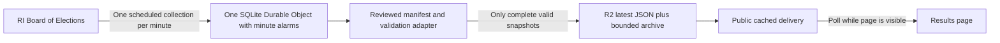

# Election Day 2026 — Results maintainer guide

This is the **single maintained guide** for the Results page in `2026/11/03/election-day`. Update this file when behavior, data, hosting or release procedures change. Machine-readable audits and test evidence stay in `data/results/` and `docs/evidence/`; they are supporting records, not separate instructions.

The page covers Rhode Island governor, Providence mayor and **Providence’s Question 7** (a municipal measure). The static viewer, source adapter, historical/mock fixtures and a Cloudflare collector implementation are present. **Live collection is not deployed or connected:** `CONFIG.endpoint` is `null`, and the collector is disabled.

**Ownership decision:** use a Herald-owned hosting account and data hostname after staff confirms them. Do not use a contributor’s personal domain or Cloudflare account. No cloud setup is authorized by the presence of the configuration files. The viewer can consume the same validated JSON from a Herald server if Cloudflare is not selected.

## Contents

- [Question for Herald staff](#question-for-herald-staff)
- [Local preview](#local-preview)
- [Reader experience](#reader-experience)
- [Reporting links and editorial choices](#reporting-links-and-editorial-choices)
- [Population representation](#population-representation)
- [Current boundaries and matching](#current-boundaries-and-matching)
- [Data architecture and collector](#data-architecture-and-collector)
- [Publishing checklist](#publishing-checklist)
- [Collector operation and deployment](#collector-operation-and-deployment)
- [Historical and mock validation](#historical-and-mock-validation)
- [Tests and asset preparation](#tests-and-asset-preparation)
- [Hosting rationale and cost assumptions](#hosting-rationale-and-cost-assumptions)
- [File map](#file-map)

## Question for Herald staff

Staff has offered to create a Herald-owned Cloudflare account and identified GoDaddy for the domain. Public DNS checked November 3 shows `ns03.domaincontrol.com` / `ns04.domaincontrol.com` as the domain's nameservers and `projects.browndailyherald.com` pointing to `thebdh.github.io`. DNS and site hosting are separate: GoDaddy manages DNS here, and the project site is on GitHub Pages.

> Could you create a Herald-owned Cloudflare account on the Free plan, using a Herald-controlled email? We can start with Cloudflare's provided address. If we later want an election-data.browndailyherald.com address, who could add the DNS record in GoDaddy? Who should receive election-night service alerts?

This is a draft to send; no staff message has been sent. Confirm the account, deployment access, available allowances and incident owner before provisioning. A DNS contact is needed only for a custom hostname. R2 activation and any billing acceptance belong to the account owner; no paid Workers upgrade is requested upfront.

**Delivery recommendation, pending implementation and deployment acceptance:** start on Free, keep the tested collector → R2 path, and add a small Pages Function that serves only the already validated JSON. A production `pages.dev` address is provided by Cloudflare, so this can launch without access to GoDaddy or a custom domain. If Herald later wants a branded subdomain, register it in Pages first and have the DNS manager add one CNAME; the rest of the domain stays at GoDaddy. This Function is not yet implemented or tested. [Pages deployment addresses](https://developers.cloudflare.com/pages/get-started/direct-upload/), [Pages custom domains](https://developers.cloudflare.com/pages/configuration/custom-domains/), [R2 bindings](https://developers.cloudflare.com/pages/functions/bindings/#r2-buckets)

The collection job still checks the official source once per minute for the entire site. Reader downloads from the Pages Function are separate: they share Workers Free's **100,000 requests/day**, resetting at midnight UTC, including requests served from the Function's cache. At one download per minute, 100 continuously active readers for eight hours generate about 48,000 requests; 200 generate about 96,000, before initial loads and other account usage. Monitor actual and projected daily usage, with an early warning around 70–80% of the allowance, and review a paid fallback only if traffic needs it. The Free limit can interrupt delivery; caching R2 reads does not remove Function invocations. R2's Standard free allowances make $0 feasible for this project, but storage and operations are metered above those allowances. The $5/month Workers minimum is an optional capacity fallback, not a launch requirement or a hard cap on all charges. [Functions pricing](https://developers.cloudflare.com/pages/functions/pricing/), [R2 pricing](https://developers.cloudflare.com/r2/pricing/), [Workers pricing](https://developers.cloudflare.com/workers/platform/pricing/)

The earlier direct-R2 delivery plan requires a Cloudflare zone in the bucket's account. A simple GoDaddy CNAME is not a Free workaround: partial external-DNS setup requires Business/Enterprise, and a separately delegated subdomain zone requires Enterprise. Do not change Herald nameservers as an election-night shortcut. Direct R2 remains an alternative only if Herald separately approves a full DNS migration; the collector does not depend on that choice. [R2 public buckets](https://developers.cloudflare.com/r2/buckets/public-buckets/), [partial setup](https://developers.cloudflare.com/dns/zone-setups/partial-setup/), [subdomain setup](https://developers.cloudflare.com/dns/zone-setups/subdomain-setup/)

## Local preview

The viewer is plain HTML, CSS and browser modules. No frontend build or npm installation is required. From the repository root, use the existing preview server or run:

```sh
python3 -m http.server 8000
```

Do not start another server if port 8000 is already serving this checkout.

| URL | Purpose |
| --- | --- |
| [Results](http://127.0.0.1:8000/2026/11/03/election-day/results.html) | Waiting state until a normalized live endpoint is configured |
| [Historical primary](http://127.0.0.1:8000/2026/11/03/election-day/results.html?mode=historical) | Official primary fixture, clearly labeled historical |
| [Simulated election night](http://127.0.0.1:8000/2026/11/03/election-day/results.html?mode=mock) | Invented counts with accelerated updates and failure controls |

Add `contest=mayor` or `contest=question7` to select a race. Governor is the default. Local mock scenarios accept `scenario=delayed`, `failure`, `malformed` or `correction`; the visible preview controls also select these. Pause and Next update allow repeatable checks.

Preview controls and test modes work only on the exact `CONFIG.previewHosts` entries: `localhost`, `127.0.0.1` and `[::1]` by default. A separate Herald staging hostname can be explicitly added for QA, but **never add the public site**. A URL parameter cannot enable previews on an unapproved host.

## Reader experience

A new **Results** tab sits alongside the existing coverage sections. The original Election Day photo hero, logo, bylines and credit match the other coverage pages. A race menu is integrated into the race heading: click/tap the heading or adjacent chevron to show one contest at a time. The menu opens 16 px below the heading. Arrow keys/Home/End move among choices, Enter/Space selects, and Escape closes and returns focus to the trigger. Outside clicks and leaving the control close it. The serif heading retains its typography; hover and keyboard focus use the shared neutral gray `--placeholder` color (`#d9d9d9`), darker than the selected item's background. Each contest has overall candidate or answer totals, inline share bars, a reporting link and an interactive map. Town, ward and precinct results appear only in floating tooltips; there are no geographic tables or below-map detail panels. The default page states that updates have not started here and links to the official results. It does not display invented numbers as live returns.

The governor map starts with Rhode Island’s **39 cities and towns**. Counties are too coarse for this coverage. Selecting a municipality opens its geographic precinct map. The mayor and Question 7 maps start with Providence’s precincts. Providence has 15 wards; ward or council-district grouping is also available in 12 other municipalities where the boundaries and reporting units permit it.

Hover or keyboard focus opens a floating tooltip with every choice’s votes and percentage, “Votes reported,” and Election Day/early/mail subtotals. Mouse tooltips follow the cursor; pinned touch details stay within the viewport. A mouse click on a town opens precincts. On a touch screen, the first tap pins the details and a second tap on that same region opens the drill-down. Enter/Space on a map region supports the same two-step selection, and a **View precincts** button is always available when the selected region can be expanded. Dragging and pinching do not count as taps. Choosing a town or ward from the area menu opens its geographic precinct map immediately when child boundaries exist. Choosing a leaf reporting area opens its tooltip instead. The area menu and arrow-key navigation provide alternatives for small shapes and keyboard users. A second tap on a precinct zooms to that precinct. A separate outline drawn above all neighboring polygons keeps the full hovered or selected border bold.

Zoom, pan, selection, map type and drill-down depth remain in place when a result update arrives. Updates do not jump the reader back to the statewide map or scroll the page. Motion preferences disable the population animation. Text, numeric totals and the legend supplement color.

All five coverage pages use the same versioned navigation script and stylesheet. The active tab's underline is its CSS border and appears immediately, with no cross-page sliding animation. Tab navigation preserves the bar's viewport position using the shared navigation logic. Initial layout changes are followed until the first pointer, touch, wheel or keyboard interaction; afterward the reader controls scrolling. A hash change or page exit also releases restoration. Results reserves at least one viewport minus the tab-bar height below the bar, even before its asynchronous maps load, so restoring a pinned bar cannot be clipped by an initially short document. Its zero top margin requires this full height; the other pages' minimum height subtracts their separate top margin. Results control styles are scoped inside its main content so the shared mobile navigation keeps the other pages' typography and focus treatment. Direct visits, reloads, back/forward navigation and explicit anchors retain their existing scroll behavior. Keep the shared script/style version consistent across all five pages when releasing navigation changes.

## Reporting links and editorial choices

The `coverage` map near the top of `results/app.mjs` controls each race’s link text and destination. All three now point into the Ballot page. `script.js` preserves explicit slide IDs and selects the linked slide before scrolling, on initial load and hash changes. The shared script URL carries a release version so a cached older script cannot overwrite the new anchor; bump that version consistently across the pages when changing slide-link behavior. Verify external background links before publication.

| Race | Current link | Other existing coverage |
| --- | --- | --- |
| Governor | [General-election candidate guide](ballot.html#governor-title) | [Final gubernatorial debate](https://www.browndailyherald.com/article/16a90458-0757-40c9-ad76-38e497cb3adf), or [Foulkes’s primary win](https://www.browndailyherald.com/article/helena-foulkes-wins-democratic-nomination-for-ri-governor-20260910) for background |
| Mayor | [General-election candidate guide](ballot.html#mayor-title) covering Morales and Talan | [Morales’s primary win](https://www.browndailyherald.com/article/draft-bi-mayor-primary-results-20260910), [Morales interview](https://www.browndailyherald.com/article/mayoral-candidate-david-morales-shares-his-vision-for-change-in-providence-20260907), or [Providence’s progressive primary wave](https://www.browndailyherald.com/article/39ed3a87-da59-4aba-b54a-11efbe48a09b) |
| Question 7 | [Question 7 explanation](ballot.html#question-7), which opens that slide directly | [Divestment referendum coverage](https://www.browndailyherald.com/article/fc4f4c85-ad28-4b70-a509-6f30c2278f22) |

The labels are “Meet the candidates →” for governor/mayor and “What Question 7 would change →” for the measure. A separate “More coverage →” link could point to `previous-coverage.html` if the editor wants multiple destinations. Candidate-specific and primary stories should be labeled as background, not a comparison of the current general-election candidates.

Editorial review item: the Morales biography in `ballot.html` currently links the word “promised” to Talan’s platform while discussing Morales’s rent-stabilization pledge. Verify and correct that source before publication; this implementation has not silently changed that reporting.

## Color and arithmetic

Candidate hues remain stable across updates: Democrat blue, Republican red, distinct colors for independents and gray for write-ins. Question 7 uses teal for Approve and orange for Reject. Historical Democratic primary candidates have distinct hues despite sharing a party.

Color identifies the current leader. Intensity represents the percentage-point lead over the runner-up, calculated using **all valid votes in that contest**, including independents and write-ins. The scale runs from 0 to 40+ percentage points. A compact key shows choice colors, no results, ties and “Darker = larger lead.” Ties for first place use equal-width stripes in the actual tied choices’ colors, including a tie among every choice. A tie among trailing choices is not a map tie. Zero votes stay neutral. The legend uses generic light/dark beige stripes (`#fcf8ef` and `#d4c7b5`), reused from this page's existing warm neutral palette; these are not claimed as official Herald brand tokens. Each map region still uses its own tied leaders. Areas without votes remain neutral; map areas without a reporting unit have a distinct boundary treatment and explanatory text. A lead is never presented as a winner call.

The candidate palette is unchanged. Distinct hues distinguish same-party candidates in historical primaries; do not use different darknesses of the same hue for identities because darkness already communicates margin. Independents have separate gold, purple and green colors, not a shared “other” color. Names and party text remain necessary, especially where light tints are hard to distinguish.

Vote shares are `choice votes / sum of all choices’ valid votes`. An unreported denominator is displayed as a dash, never a fabricated percentage. An undervote is no selection in a single-choice contest; an overvote is more selections than allowed. Neither contributes to a candidate/answer vote share. The selected export does not provide a dependable per-contest undervote/overvote series here, so those counts are not invented. “Reporting units reported” is **not** “percent of votes counted,” and does not mean all mail, provisional or corrected votes are final.

## Population representation

The governor map can switch between **Geographic** and **Population**. Population means the July 1, 2025 resident population, including children and people who cannot or do not vote. It does not mean votes cast, registered voters or turnout. The weights remain fixed throughout election night. The municipality’s results, color, controls and selection stay the same during the switch. Opening a town always uses geographic precincts; returning to the state restores the prior map choice.

The population map is a precomputed continuous area cartogram. A shared deformation moves the municipalities’ common border vertices together. It is not a collection of independently scaled shapes, and it does not require runtime geographic computation in the collector. Coastlines deform and islands remain islands. The browser interpolates corresponding vertices over 750 ms.

Weights come from the [U.S. Census Bureau’s 2025 municipal estimates, published by RI DLT](https://dlt.ri.gov/sites/g/files/xkgbur571/files/2026-05/townest.pdf). The 39 figures sum to 1,114,521 residents. The build uses a local Albers equal-area projection, shared boundary simplification and the continuous-area method described by Dougenik, Chrisman and Niemeyer. The final asset’s maximum relative error between a town’s area share and population share is **0.100%**. Forty-one animation positions were checked before and after serialization for valid polygons, overlapping area and shared-border coverage. See [the geographic audit](data/results/geography-audit.json).

The geographic assets are generalized for display: precinct boundaries use a 20-meter simplification; statewide town outlines use 65 meters followed by a shared 5-meter precision grid to remove tiny source slivers. The latter changes any municipality’s area by at most 0.279% beyond simplification. Precinct detail does not use the extra town-level grid. These are thematic election maps, not address or legal-boundary lookup tools.

## Current boundaries and matching

Use the [current published RIGIS precinct service](https://services2.arcgis.com/S8zZg9pg23JUEexQ/ArcGIS/rest/services/BND_Voting_Precincts_2022/FeatureServer/0), checked November 3, 2026. Its name refers to the 2022 redistricting cycle. Its data was last edited November 27, 2023; its service metadata was edited September 11, 2024 and catalog item January 6, 2025. Those dates are not interchangeable. The audit found no newer statewide precinct layer. A separate service named `Voting_Precincts` is older, despite its newer catalog-modification date.

The general-election governor source contains **454 reporting units**: 414 geographic precincts that match polygons and 40 LIMITED units without geographic boundaries. All ordinary reporting codes matched. Providence governor has 82 geographic precincts plus two LIMITED units; mayor and Question 7 each have 82 geographic precincts and no LIMITED units. Nongraphic votes remain included in town/state totals and are disclosed in details, but never assigned to invented polygons.

A fresh general-election export checked at 18:31 UTC on November 3 contains **no combined precinct units** for these three contests. Primary governor data has 41 combined reporting groups; that is a historical-source fact, not an assumption about this election. General and primary have separate reviewed manifests. If the live source changes its grouping, the collector retains the last valid publication and reports a validation error until the new roster is reviewed.

The GIS layer contains 416 polygons. Preserve its two additional areas:

- **Cranston 0727:** the city’s [November 2026 election warrant](https://www.cranstonri.gov/nov-3-2026-general-election-warrant-and-polling-places/) says no voters and no polling place. Label it accordingly.
- **Providence 28XX:** the city’s [current Ward 12 PDF](https://www.providenceri.gov/wp-content/uploads/2026/05/ward-12.pdf) includes this area, but the results export has no matching unit. Label it “No results reported for this map area.” Do not alias it to another precinct or imply a reported zero.

The current [Providence ward PDFs](https://www.providenceri.gov/canvassers/ward-maps/) support the GIS ward membership. The Ward 8 PDF omits the label 2806, but the polygon, the current polling-location service and the election’s Ward 8 council contest support its membership. Sixty-nine current council contests across 12 municipalities matched the GIS groups with no discrepancies. This validates identifiers and grouping; it is not an exhaustive survey of every boundary line in all 39 municipalities.

| Municipality | Grouping |
| --- | --- |
| Central Falls | 5 wards |
| Coventry | 5 council districts |
| Cranston | 6 wards |
| Cumberland | 5 council districts |
| East Providence | 4 wards |
| Johnston | 5 council districts |
| Lincoln | 5 council districts |
| Newport | 3 wards |
| North Providence | 3 council districts |
| Pawtucket | 6 council districts |
| Providence | 15 wards |
| Warwick | 9 wards |
| West Warwick | 5 wards |

Cumberland’s current council terms do not require a 2026 council contest; its current town materials and fire-district contests support the five groups. Some West Warwick wards elect in alternating cycles. Do not infer the total number of wards from just the contests on one ballot.

The join key is the **public four-character geographic code**, with leading zeros retained. Internal BOE precinct IDs and polling-place names are not unique. For combined historical units, extract all four-digit codes from the final parenthetical, including labels separated with periods, and retain one combined result. Detect LIMITED units before extracting codes. Reject unknown codes, wrong-town codes, overlapping code sets or missing expected coverage.

## Data architecture and collector



The source is fetched **once per collection cycle for the whole site**, independent of reader count. Readers periodically download the same small normalized file. They do not contact the Board of Elections or trigger a new collection. Push connections are unnecessary for this update cadence. Polling can add up to another minute of reader delay after publication; source caching and edge caching must also be accounted for.

The main source is the [official full general-election JSON export](https://electionresults.ri.gov/cdn/results/RhodeIsland/export-2026StatewideGeneralElection.json). Its observed cache lifetime is 60 seconds. The reviewed IDs are governor 4, Providence mayor 280 and Providence Question 7 417. The host-independent adapter is `results/boe-adapter.mjs`; it validates against `data/results/general-manifest.json`. The manifest is a reviewed build artifact, not something regenerated automatically in response to an unexpected election-night roster change.

The browser connection point is **`CONFIG.endpoint` in `results/config.mjs`, currently `null`**. The existing, undeployed collector implementation uses a Free SQLite Durable Object; provision it only in a Herald-approved account if staff selects that host. The normalized contract keeps the viewer independent of the host. The service must publish the normalized contract below over HTTPS, allow the project’s origin via CORS when cross-origin, and expose no credentials to the browser.

The implementation includes durable minute alarms, a five-minute alarm-repair watchdog, conditional source requests, bounded downloads, validation, changed-source gzip archives, atomic publication, restart recovery and authenticated administration. Cloud storage provisioning, custom-domain delivery, CDN/CORS behavior and alert delivery remain deployment tasks. No production service or paid subscription has been created.

### Snapshot contract

| Field | Meaning |
| --- | --- |
| `schemaVersion` | `1`; incompatible versions are rejected |
| `electionId` | `ri-2026-general` for live, `ri-2026-primary` for the historical fixture |
| `mode` | `live`, `historical` or `mock`; a mock snapshot cannot enter the live feed |
| `revision` | Nonempty identifier for the source version or normalized content |
| `sourceUpdated` | Time supplied by the election source, not the browser’s clock |
| `publishedAt` | Time this validated publication was produced |
| `checkedAt` | Most recent successful collection/validation check |
| `status` | `waiting`, `unofficial`, or explicitly verified `certified` |
| `source` | Public source label and URL |
| `contests` | Exactly `governor`, `mayor`, `question7` |

Each contest has stable choice IDs, names, parties and colors, plus `areas` keyed by state, municipality, precinct/reporting group or ward. Each area has candidate-aligned `votes`, a `total`, three candidate-aligned voting-method arrays, reporting-unit counts, a status and any nongraphic votes. `geometryIds` lists every polygon belonging to a reporting unit. Combined historical units keep all their polygons under the same result. An unavailable historical contest has `available:false` and no fabricated areas. The prepared fixture files are working examples.

Reject negative, fractional or unsafe-integer counts; changed election/candidate identities; missing or duplicate reporting units; unexpected status/method values; non-reconciling candidate, method, ward, town or state totals; and older snapshots. Accept a newer legitimate correction even when votes decrease. Publish the entire three-contest file atomically only after validation passes. Keep the preceding valid snapshot on any failure. A future multi-endpoint collector must additionally verify all fragments belong to one source publication version before publishing.

The browser validates received snapshots again, enforces a 2 MB decoded-response limit and a 12-second request timeout, ignores obsolete responses after a mode change, and retains the last good data in memory and optional local storage. It polls every 60 seconds while visible, pauses polling while hidden, checks immediately on return and backs off to at most four minutes after failures. It never silently replaces a rejected update with zeros.

Freshness is based on the collector’s **`checkedAt`**, not successful delivery of an old cached file. A live snapshot more than three minutes past its last successful collection check is labeled delayed. `sourceUpdated` remains separate because unchanged official results can still be checked successfully. The default unconnected placeholder does not claim a live check time.

### Start, activity indicator and stopping

Rhode Island polls close at **8 p.m. Eastern on November 3, 2026**. The shared default `LIVE_STARTS_AT` in `results/schedule.mjs` is `2026-11-04T01:00:00Z` (EST, UTC−5, not daylight time). The viewer uses `CONFIG.startsAt`; the deployed collector uses `COLLECTION_STARTS_AT` with the shared constant as fallback. Keep them aligned if deliberately changing the schedule. [Official polling hours](https://elections.ri.gov/polling-hours)

With a real endpoint configured, an open page loads the honest waiting fixture before the start and automatically requests the endpoint at the start boundary, without a reload. A later visitor starts immediately. The collector must first be deployed, enabled and **armed using `/admin/start`**: before 8 p.m. that persists an alarm for 8 p.m.; after 8 it schedules the first eligible check about one second later. Manual checks, early alarms and watchdog recovery cannot fetch before the configured start. The watchdog never arms a deliberately stopped collector. Scheduled alarms and network delivery can run late, so “8 p.m.” is the start of checking, not a guarantee that votes exist at that instant. This checkout remains disabled and disconnected, so the schedule alone does not make production live.

The small red dot beside “Election results” pulses only after a fresh, valid live check while automatic updates are active. Fresh zero-count results also qualify: the service is checking for returns. It is off for unconfigured/scheduled/historical data, hidden tabs, errors, stale snapshots and a paused simulation. A running mock preview can exercise it, but remains prominently labeled simulated and has a simulation-specific accessible label. Reduced-motion preferences use a steady red dot. “Actively updating” means automatic checks are healthy, not that votes increased on every check.

**Stop policy:** do not stop at midnight, at 100% reporting units, on a lead or on a race call. Mail/provisional counts and corrections can arrive later. Recommend retaining minute checks through election night, then agreeing with editors on a slower follow-up cadence and a final archive after certification. The slower cadence/final archive mode is not implemented. The existing `COLLECTION_ENDS_AT = 2026-11-30T23:59:59Z` is an operational safety cutoff, not an assertion that counting/certification is complete; the incident owner must review/extend it before then if needed. `/admin/stop` preserves the latest file, but its health becomes stale and the live dot turns off. For a planned final archive, publish an explicit editorial end-of-coverage state instead of disguising a stopped service as healthy. That archive state needs implementation before using it.

### Collector behavior and launch requirements

Use conditional requests (ETag/Last-Modified) where supported, explicit response-size and timeout limits, and a timeout timer cleared after success. A successful not-modified response may advance the health check without changing vote data. Preserve source timestamps and record the original source hash/version for audit. Fetch failure, changed schema, unknown geography or reconciliation failure keeps the last good publication and records an actionable error.

For a Durable Object, use one named object for the election and its one-shot alarm. Persist state, schedule the next alarm deliberately, avoid overlapping collections and make retries safe. The local workerd integration suite verifies repeated minute alarms, SQLite restart recovery and R2 publication. These checks still need confirmation against the deployed service, real R2 and custom-domain CDN. Keep readers outside the object. Use short, explicit CDN caching for the latest file, immutable versioned snapshots where useful, and retention/changed-only rules for source archives. Cache lifetime is an expiration policy, not an obligation to delay new data for 60 seconds. Do not use cache-busting URLs per reader.

An incident contact and a lightweight health monitor should alert on sustained collection failure or rejected source changes. These alerts require an owner and delivery destination; none has been configured or sent. Keep an official-source link visible during an outage. Do not automatically call races or promote an unofficial source to certified without an explicit trustworthy certification signal or reviewed editorial action.

## Publishing checklist

### What happens automatically

| Behavior | Public site | Approved local/staging host |
| --- | --- | --- |
| Preview controls | Hidden from the initial HTML render onward | Available via “Preview test data” |
| `?mode=mock` / `?mode=historical` | Ignored and removed from the URL; only live/waiting data is accepted | Opens the requested labeled test feed |
| Feed mode switching | Cannot enter mock/historical mode without preview permission | Test mode switching allowed |
| Test banners | Absent because no test feed is shown | Persistent warning whenever test data is displayed |
| No configured endpoint | Honest waiting state and official-results link | Same waiting state, plus optional tests |
| Failed or rejected update | Last valid data retained, with delayed/unavailable status | Same behavior; mock controls can simulate it |

**There is no manual “remove preview UI” step for normal publication.** Keep production out of `previewHosts`. These controls are an editorial safeguard, not an access-control system: the repository and fixture files can remain publicly downloadable under GitHub Pages. They contain public historical or explicitly synthetic data, never secrets. If a future release must omit test assets entirely, prepare an explicit deployment bundle rather than assuming hidden controls make the files private.

### What a maintainer must do

1. **Confirm Herald ownership and hosting.** Get the staff answer above. Configure only the approved account, data hostname, incident contact and budget. Personal infrastructure is excluded.
2. **Deploy and validate the collector/delivery path.** Complete the deployment acceptance steps below with actual storage, HTTPS, CORS, CDN cache lifetime and failure monitoring. Local tests are not evidence that a deployed CDN is correct.
3. **Review the current official source.** Confirm election identity, the three contest IDs, all candidates/answers and reporting-unit membership still match the reviewed general manifest. Validate totals and geography. Do not automatically regenerate the manifest to bypass a rejection.
4. **Set the live endpoint.** In `results/config.mjs`, set `CONFIG.endpoint` to the public HTTPS URL of the normalized shared snapshot (not the raw BOE export). The endpoint needs no reader credentials and must allow the Herald project origin through CORS. Keep `endpoint: null` if intentionally publishing only a waiting page; that is not a live-results launch.
   Verify `COLLECTION_STARTS_AT` and `CONFIG.startsAt` both correspond to 8 p.m. Eastern, enable and arm the deployed collector before then, and confirm `/admin/status` shows `phase: scheduled` and the expected `nextAlarm`. Recheck at the start for advancing `checkedAt` and healthy delivery. An unarmed collector will not start itself just because a reader visits.
5. **Review presentation and reporting.** Verify hero/bylines/credit against the other pages, all three link destinations, candidate/answer labels and colors, the issue noted in the reporting-links section, and the official-source attribution. Keep “Unofficial” unless trustworthy certification evidence supports a change. No automatic race calls are made.
6. **Run the checks.** Run the viewer/adapter tests and collector tests if its code/configuration changed. Check all three races, desktop and narrow/mobile layouts, mouse/keyboard/touch details, town/ward drill-down, tie colors, no-results areas, population view and a rejected update retaining the last good data.
7. **Test the public-host behavior.** On an unapproved preview host, verify no test controls or banners appear, adding mock/historical query parameters still shows live/waiting data, and the browser never downloads a test fixture. `http://localhost.:8000/2026/11/03/election-day/results.html?mode=mock` can exercise this host gate locally when `localhost.` resolves on the machine; it intentionally is not an approved preview host. Repeat on the actual published hostname after release.
8. **Review and publish deliberately.** Keep project edits inside `2026/11/03/election-day`. GitHub Pages was verified on November 3, 2026 to publish `main` from root `/`. Pushing only `nikos-branch` allows code review but does not update production or create an automatic rendered preview. Re-check repository publishing settings before a later release. Publishing to `main` or deploying the service requires separate authorization.
9. **Check the published page and monitor.** Confirm successful live fetches and advancing collector `checkedAt` across several minute cycles, compare all three totals with the official source, and verify an actual alert reaches the designated incident owner. Keep the published URL free of test parameters.

## Collector operation and deployment

One SQLite Durable Object, named `ri-2026-general`, owns a persistent minute alarm and the last validated snapshot. It fetches the official general-election export, validates all three contests against `data/results/general-manifest.json`, archives changed source versions, then replaces `ri-2026-general/latest.json` with one atomic R2 write. The general manifest currently expects individual precinct units; combined primary groups are not reused for the general election.

- Conditional ETag/Last-Modified requests avoid unnecessary processing. A valid 304 advances `checkedAt`, preserving source time, revision and votes.
- The source request has a 20-second timeout, a 20 MB decoded-body limit and a JSON content-type check. Redirects are rejected. The timeout is cleared after completion.
- Unknown election, candidate or reporting identities; wrong geography; inconsistent totals; invalid counts; future timestamps; and older source versions are rejected. New downward corrections are accepted.
- All three contests publish together. A source or R2 failure preserves the last good publication. SQLite persists a pending publication so an interrupted write can be retried safely after restart without fetching again.
- A persisted attempt timestamp and an in-process lock prevent overlapping or duplicate minute collections. The next alarm is saved before external work. Failures back off to four minutes, or honor a bounded `Retry-After` up to 15 minutes. A five-minute Cron repairs missing/overdue alarms without restarting an intentionally stopped collector.
- `COLLECTION_STARTS_AT` gates every collection. Arming in advance persists the future start; no reader or manually requested check bypasses it. The status response exposes `phase`, `startsAt` and `endsAt`.
- Collection automatically ends at `COLLECTION_ENDS_AT` (currently November 30, 2026, 23:59:59 UTC). An invalid date disables collection. Stopping waits for an active publication and cancels the next alarm.
- The latest file carries `max-age=0, s-maxage=15, must-revalidate`. Immutable source and prepared snapshots are written only when the source/approved manifest changes. Lifecycle rules retain these archives for 72 hours; the latest file does not expire. Save an editorial archive separately before retention removes it if needed.

SQLite contains metadata, current snapshot and pending snapshot in separate rows. Credentials are only in a Worker secret. The administrative Worker exposes no reader endpoint.

### Herald account and delivery setup

If staff selects Cloudflare, use the Herald-owned account and confirm the approved delivery approach. Do not use a personal account or move any domain to work around missing access. The prepared configuration intentionally has no account ID. **With the current GoDaddy DNS, follow the Pages delivery branch below; direct R2 requires a separately approved Cloudflare DNS zone.**

1. Connect the approved Herald account and verify its ID, approved plan/allowances and R2 activation. R2 enrollment/billing acceptance is an account-owner action; this project has not enabled it or a paid plan.
2. Create an R2 **Standard** bucket named `herald-election-results-2026`. Apply `collector/r2-cors.json` and `collector/r2-lifecycle.json` using the R2 API or dashboard. These files match the current API schemas. Limit public storage to this election's public data; no credentials belong in the bucket.
3. **Recommended with GoDaddy DNS:** implement/test a small Pages Function with an R2 binding and serve only the approved normalized object path. Start with its production `pages.dev` address; no GoDaddy access is required. An optional Herald subdomain must first be registered in the Pages project's custom domains, then its DNS manager can add the GoDaddy CNAME. Serve CORS and appropriate cache headers from the Function, including error responses; keep credentials/admin paths private. Reader requests must never run the collector. **Alternative, only with a separately approved Cloudflare DNS zone:** connect the data hostname directly to the bucket in the same account using R2's custom-domain association. Never CNAME to `r2.dev`.
4. Verify explicit 15-second edge freshness and browser revalidation for the latest JSON; never override it with a long default TTL or cache stale content indefinitely. For a Pages Function, implement/test its caching path and account for Function invocations even when data is cached. For direct R2, use a hostname/path-scoped Cache Rule making JSON eligible and respecting origin cache-control. Verify actual deployed behavior rather than assuming it from metadata.
5. Verify the CORS response for `https://projects.browndailyherald.com`, including cached responses. Localhost origins are included for local acceptance testing and can be removed afterward. CORS is browser access configuration, not protection for public election data.
6. Set the verified account ID in Wrangler or the deployment environment. Deploy the code disabled. The SQLite migration creates `ElectionCollector`; the five-minute Cron is only an alarm watchdog. Add a randomly generated secret of at least 32 characters as `ADMIN_TOKEN` using the Cloudflare secret interface. Never put it in source, URLs, screenshots or the viewer.
7. Arrange a newsroom incident owner and independent monitor before enabling live service. Monitor the public file's `checkedAt` and the authenticated status endpoint; alert after more than three minutes without a successful check, repeated rejection, missing alarms, quota exhaustion or delivery failure. On Free, also monitor total account request usage and forecast it to the next midnight UTC reset; warn around 70–80% of the daily allowance so staff can decide whether extra capacity is needed before delivery fails. A successful HTTP response alone is not a health check. No alert destination or quota monitor is currently configured.

### Administration and launch acceptance

The Worker has these authenticated endpoints. All require `Authorization: Bearer <ADMIN_TOKEN>`; send credentials only to the verified collector hostname. Responses are not cached.

| Method / path | Behavior |
| --- | --- |
| `GET /admin/status` | Phase (`disabled`, `stopped`, `scheduled`, `running`, `ended`), configured start/end, last attempt/check/publication, revision, failures, pending publication, next alarm and staleness |
| `POST /admin/check` | One collection after the start boundary, with the same persisted one-minute guard; no continuous schedule is started |
| `POST /admin/start` | Arm the 8 p.m. start in advance; if already past the start, first eligible check is about one second later |
| `POST /admin/stop` | Stop scheduling, wait for active work, remove the alarm |

Keep the viewer disconnected until acceptance is recorded:

1. Verify public delivery, TLS, CORS, cache headers and the actual 15-second cache lifetime using the new hostname. Confirm the JSON remains current across cache locations and the page's visible/hidden polling cycle.
2. In an isolated staging bucket/object, run populated mock returns, a downward correction, bad-source and storage-failure cases; demonstrate that the last valid snapshot remains available. Never put mock data at the public production key. The source URL in the shipped collector is fixed to the official export.
3. In isolated staging, use a deliberate past `COLLECTION_STARTS_AT` to verify real collection, repeated alarms, R2 writes, restart recovery, quotas and monitoring before election night. In production, retain the 8 p.m. boundary, enable collection and arm `/admin/start` in advance; verify its scheduled phase/alarm. At/after 8, compare all three totals and precinct coverage with the official source and verify repeated successful checks. A late launch should start immediately after acceptance. The earlier remote prototype demonstrated compute feasibility, not these checks.
4. Confirm the latest source roster still matches the reviewed general manifest. A mismatch requires review of the source and boundaries; do not auto-regenerate the manifest to silence validation. Keep unpublished or stale data clearly labeled while investigating.
5. Set `CONFIG.endpoint` in `results/config.mjs` to the verified HTTPS URL ending `/ri-2026-general/latest.json`. Verify the live viewer on desktop and iPhone Safari. Sharing code on `nikos-branch` is separate from publishing to `main` or deploying the service.

For an incident, stop the collector if its inputs/configuration are suspect, retain the last good file, inspect the structured error log and public `checkedAt`, and link readers to the official source. Do not replace failed results with zeros or update `checkedAt` merely to hide an outage. Once the cause is corrected, validate a one-shot check and restart. If Free quotas prove insufficient, review a paid fallback before upgrading.

## Historical and mock validation

The historical fixture comes from the [official 2026 primary export](https://electionresults.ri.gov/cdn/results/RhodeIsland/export-RI2026StatewidePrimary.json), retaining its source date exactly. The UI labels it “2026 Democratic primary,” not general-election returns. The statewide Democratic governor totals reconcile to Foulkes 81,314 and McKee 48,872; Providence mayor reconciles to Morales 14,299 and Smiley 12,961.

Primary governor units cover the same 414 geographic precincts in fewer combined reporting groups. Combined units that cross wards make historical ward totals unavailable in **Central Falls, Cumberland and Lincoln**. Their maps display combined reporting regions; no population-based allocation of their votes is performed. The old disposable benchmark’s last-code-only spatial mapping was unsuitable and has been replaced in the implementation.

Question 7 was not on the primary ballot, so the historical mode explicitly marks it unavailable. Its current roster/structure and arithmetic are tested with the reviewed general export and synthetic populated results. A historical referendum comparison remains useful additional coverage; this implementation does not claim one was performed.

Mock mode has a persistent simulation label and accelerated eight-second updates. Controls exercise normal partial returns, delayed updates, connection failure, malformed data and a downward correction. The seeded counts are invented solely for interface testing. Original official exports and geometry are retained as compressed fixtures, with source hashes and timestamps, so validation can run offline.

Automated checks cover official reference totals, full geographic coverage, combined groups, incorrect identities, unsafe counts, missing/duplicate units, subtotal inconsistencies, source ordering, corrections, response limits, last-good retention, mode races, hidden-tab polling and retry backoff. Geometry checks validate population-area error and animation topology separately. Browser review covers waiting, historical and mock views, map switching, drill-down, keyboard controls and responsive layout.

Verification recorded November 3: the original 32 viewer/adapter tests passed, module syntax checks and `git diff --check` passed, and the browser reported no JavaScript warnings or errors. At a 390-pixel viewport the page had no horizontal overflow. Browser checks confirmed population-to-precinct navigation and return, Providence's 15 wards, the unmatched 28XX area, historical combined precincts, keyboard region navigation, and retention of displayed results after an invalid update. A later iPhone Simulator Safari check confirmed first-tap details, second-tap town drill-down and precinct details. Physical-device gestures, reduced-motion behavior on a physical device, and a production collector/CDN connection still require final acceptance testing.

The updated viewer suite contains **39 passing tests**, including timed startup, truthful activity status, production preview isolation and multi-way tie-color coverage. The collector verification includes 25 engine tests and three actual local Cloudflare runtime tests. See [the verification record](docs/evidence/collector-verification.json); remote deployment acceptance is still outstanding.

## Tests and asset preparation

Use Node 24 and, from `2026/11/03/election-day/collector`:

```sh
npm ci
npm test
npm run check
```

`npm test` runs 25 engine tests plus three Cloudflare workerd/Miniflare integration tests. One integration test deliberately takes about two minutes: it observes three naturally scheduled minute alarms, a 304 and a downward correction. It uses synthetic upstream responses, local SQLite/R2 and temporary local directories that it removes. No credentials or cloud deployment are needed. The test-only bearer token is not a deployment credential. Miniflare is pinned to the version bundled with Wrangler; it is a development dependency only.

The other runtime tests check authentication, wrong methods, publication of the full official-shaped export, reader/collector isolation, persisted state after restart, and an armed future start that cannot fetch early but wakes automatically at its boundary. Engine tests inject timeouts, malformed data, bad totals, changed grouping, oversized bodies, redirects, archive/publication failures, interrupted SQL commits, simultaneous requests, stop-during-publication and invalid start/end windows. The viewer/adapter has 39 tests: run `node --test tests/results.test.mjs` from the parent project directory.

`npm run check` builds with Wrangler's dry-run option and does not deploy. Dependency audit on November 3 reported zero known vulnerabilities. Generated `.build`, `.wrangler`, types, node_modules and local secret files are ignored.

To rebuild fixtures, unpack the two `tests/fixtures/*-export.json.gz` files and `precincts.geojson.gz` into a temporary directory, then run:

```sh
node scripts/build-fixtures.mjs /path/to/unpacked-sources /path/to/unpacked-sources/precincts.geojson
```

To regenerate geographic assets, use Python with `numpy`, `shapely>=2.1` and `pyproj` installed in a separate virtual environment:

```sh
python scripts/build-geography.py /path/to/unpacked-sources/precincts.geojson
```

Both preparation commands write only this project's reviewed data assets. Check the geographic audit and historical reference tests after regenerating. Rebuilding a manifest from changed source content requires reviewing election IDs, candidates and geographic coverage before using it for live collection.

## Hosting rationale and cost assumptions

These estimates were checked November 3, 2026; verify current limits and account-wide usage before provisioning. They are not a zero-dollar spending cap.

The ordinary Workers Free HTTP/Cron implementation measured 162–368 ms CPU, exceeding its documented 10 ms allowance. Splitting it across many jobs adds version coordination, incomplete-fragment recovery and quotas: Free has five Cron triggers; KV’s 1,000 daily writes are below one write per minute; Queues’ 10,000 daily operations are below even three three-operation jobs per minute. This is why the implementation uses one SQLite Durable Object instead. [Workers limits](https://developers.cloudflare.com/workers/platform/limits/), [KV pricing](https://developers.cloudflare.com/kv/platform/pricing/), [Queues pricing](https://developers.cloudflare.com/queues/platform/pricing/)

A temporary remote SQLite Durable Object prototype measured 233 ms CPU for a manual invocation and 254 ms for an alarm, within the DO’s documented 30-second default allowance. It saved its result successfully, and the temporary resources were removed. Its alarm’s 20-second wall time likely included an uncleared timeout; the implemented collector clears its timer. This was a compute feasibility experiment, not deployed R2/CDN acceptance. [DO limits](https://developers.cloudflare.com/durable-objects/platform/limits/), [alarm behavior](https://developers.cloudflare.com/durable-objects/api/alarms/), [preserved evidence](docs/evidence/durable-object-results.json)

Free DO allowances included 100,000 requests, 13,000 GB-seconds and 100,000 SQLite rows written per day, plus 5 GB storage. At 1,440 minute checks/day, a conservative 20 active seconds/check estimates 3,686.4 GB-seconds/day; one active second/check estimates 184.32. Ten row writes/check would be 14,400/day. Real usage must be observed after deployment, including alarms, watchdog and retries. Readers stay outside the object. [DO pricing](https://developers.cloudflare.com/durable-objects/platform/pricing/)

R2 Standard included 10 GB-month, one million Class A operations and ten million Class B operations monthly, with free Internet egress. Above allowances: $0.015/GB-month, $4.50/million writes and $0.36/million reads, subject to billing rounding. Enrollment can require billing details and allow metered overages. These allowances do not apply to Infrequent Access storage. [R2 pricing](https://developers.cloudflare.com/r2/pricing/)

| Example workload | Estimated usage before retries/other account usage |
| --- | --- |
| Latest snapshot once a minute for 30 days | 43,200 writes |
| Latest + raw source + prepared archive on every minute for 30 days | At most 129,600 writes |
| 72 hours of 307 KB prepared snapshots, even including duplicates | About 1.33 GB |
| 10,000 continuously active readers polling for eight hours, no CDN hits | 4.8 million reads |
| 100,000 continuously active readers under the same assumption | 48 million reads; about $13.68 above the included ten million reads |

This table describes R2 usage only. The proposed Pages Function has the separate 100,000-request daily Free limit described above, so the high-reader examples would exceed that delivery allowance even if R2 reads remained free.

The prepared populated snapshot is about 307 KB uncompressed / 49 KB compressed. Raw exports are much larger; retain only changed versions, gzip them and enforce the 72-hour archive lifecycle. CDN hits reduce R2 reads. Pages Function delivery requires an explicitly implemented and tested caching path. With the alternative direct-R2 delivery, the latest JSON needs a cache-eligibility rule because JSON is not automatically cached by file extension. R2 custom domains must share an account with the bucket, and the rate-limited `r2.dev` endpoint is for development, not production. [Public buckets](https://developers.cloudflare.com/r2/buckets/public-buckets/)

If a paid fallback is needed, the ordinary Workers $5/month base included ten million requests and thirty million CPU milliseconds. The benchmark’s median projects about eleven million monthly CPU milliseconds for minute collection; the slowest run projects about sixteen million. These are planning estimates, not authorization to upgrade. [Workers pricing](https://developers.cloudflare.com/workers/platform/pricing/)

## File map

| Path | Purpose |
| --- | --- |
| `README.md` | This single maintained specification, handoff and publishing guide |
| `results.html`, `results.css`, `results/app.mjs` | Results markup, heading selector, summary and interactive maps |
| `styles.css`, `script.js`, `assets/hero-faunce.jpg` | Shared site hero, authors, navigation, countdown and live-update teaser |
| `results/config.mjs` | Normalized endpoint, preview-host allowlist, polling and size limits |
| `results/schedule.mjs` | Shared 8 p.m. Eastern start constant for the viewer and collector |
| `results/feed.mjs`, `results/model.mjs` | Browser delivery, preview isolation, last-good retention and contract validation |
| `results/map-colors.mjs` | Leader/tie calculation and map palette helpers |
| `results/boe-adapter.mjs` | Official-source validation and normalization, shared with the collector |
| `results/mock.mjs` | Deterministic synthetic election-night simulation |
| `data/results/` | Reviewed manifests, prepared fixtures, provenance and geometry audits |
| `assets/results/geography.json` | Shared geographic and population geometry |
| `scripts/` | Offline source-fixture and map preparation |
| `tests/` | Viewer/adapter tests and compressed official fixtures |
| `collector/src/` | Durable Object collection engine, persistence, publication and admin interface |
| `collector/wrangler.jsonc`, `collector/r2-*.json` | Disabled collector configuration and proposed storage rules |
| `collector/tests/` | Failure injection and local Cloudflare runtime tests |
| `docs/evidence/` | Supporting benchmark and verification records |

The former plan, hosting assessment and collector README have been consolidated here to avoid conflicting instructions. Maintain this file as the source of truth.
